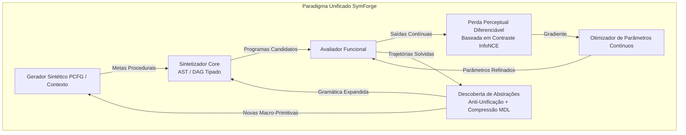
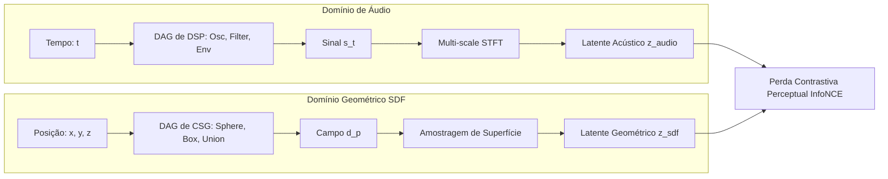
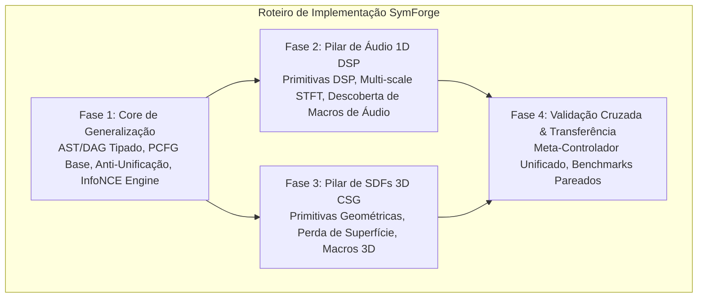

# Arquitetura Unificada de Síntese Neurosimbólica: Áudio, SDFs e Generalização

## 1. Visão Geral e Princípio Unificador

O **SymForge** é concebido como um framework neurosimbólico universal para a síntese procedural de programas estruturados (ASTs e DAGs tipados), operando sobre uma **isomorfia fundamental**: tanto a síntese de áudio (Processamento Digital de Sinais - DSP) quanto a síntese de superfícies implícitas (Signed Distance Functions - SDFs) são instâncias do mesmo problema matemático:

> **Problema Fundamental:** Descobrir e parametrizar uma composição pura de operadores conhecidos $f_{G, \theta}: \mathcal{X} \to \mathcal{Y}$, guiada por dados sintéticos gerados proceduralmente e otimizada por uma **função de perda diferenciável perceptual baseada em contraste**, promovendo padrões recorrentes a novas abstrações reutilizáveis.

```text
+---------------------------------------------------------------------------------------------------+
|                                  PARADIGMA UNIFICADO DO SYMFORGE                                  |
|                                                                                                   |
|  +--------------------+       +----------------------+       +---------------------------------+  |
|  |   PCFG / Context   | ----> |  Sintetizador Core   | ----> |  Perda Diferenciável Perceptual |  |
|  | Gerador Sintético  |       | (AST / DAG Tipado)   |       |       Baseada em Contraste      |  |
|  +--------------------+       +----------+-----------+       +----------------+----------------+  |
|            ^                             |                                    |                   |
|            |                             v Descobertas                        v Gradientes        |
|            |                  +----------+-----------+               +--------+-------+           |
|            +----------------- | Descoberta Abstração | <------------ |   Otimizador   |           |
|            Novas Primitives   | (DreamCoder / MDL)   | Trajetórias   |   Contínuo     |           |
|            na Gramática       +----------------------+ Aceitas       +----------------+           |
+---------------------------------------------------------------------------------------------------+
```



---

## 2. As Três Divisões do Projeto

O desenvolvimento do SymForge é formalmente estruturado em três pilares sinérgicos:

### 2.1 Pilar 1: Sintetizador de Áudio (DSP Procedural)
- **Espaço de Coordenadas:** $\mathcal{X} = \mathbb{R}$ (Tempo contínuo $t$).
- **Espaço de Saída:** $\mathcal{Y} = [-1, 1]$ (Amplitude sonora normalizada).
- **Primitivas Base Conhecidas:**
  - *Geradores / Osciladores:* `Sine(freq, phase)`, `Sawtooth(freq)`, `Square(freq, duty)`, `Triangle(freq)`, `Noise(seed)`.
  - *Moduladores & Envelopes:* `ADSR(a, d, s, r)`, `ExpDecay(rate)`, `LFO(freq, shape)`, `FM(carrier, mod, index)`.
  - *Filtros & Transformações:* `LowPass(cutoff, resonance)`, `HighPass(cutoff, resonance)`, `BandPass(center, q)`, `Gain(gain)`, `Mix(sig1, sig2, balance)`.
- **Desafio Perceptual:** Erros ponto a ponto ($L_1 / L_2$ no domínio do tempo) falham catastroficamente: sinais idênticos ao ouvido com ligeiro deslocamento de fase produzem erro máximo.
- **Perda Perceptual de Contraste:** Extração de representação tempo-frequência (Multi-scale STFT / Mel-Spectrogram) projetada em espaço latente acústico com contraste InfoNCE entre o alvo e perturbações/distratores.

### 2.2 Pilar 2: Sintetizador de SDFs (Geometria Implícita)
- **Espaço de Coordenadas:** $\mathcal{X} = \mathbb{R}^d$ ($d=2$ ou $d=3$, vetor de posição $\mathbf{p} = (x, y, z)$).
- **Espaço de Saída:** $\mathcal{Y} = \mathbb{R}$ (Distância euclidiana com sinal à superfície mais próxima; $f(\mathbf{p}) < 0$ interior, $f(\mathbf{p}) > 0$ exterior).
- **Primitivas Base Conhecidas:**
  - *Formas Primitivas:* `Sphere(radius)`, `Box(half_extents)`, `Cylinder(radius, height)`, `Torus(major_r, minor_r)`, `Plane(normal, offset)`.
  - *Transformações Espaciais:* `Translate(sdf, offset)`, `Rotate(sdf, angles)`, `Scale(sdf, factor)`.
  - *Composições CSG & Misturas:* `Union(sdf1, sdf2)`, `Difference(sdf1, sdf2)`, `Intersection(sdf1, sdf2)`, `SmoothUnion(sdf1, sdf2, k)`, `ChamferUnion(sdf1, sdf2, r)`.
- **Desafio Perceptual:** O interior profundo e regiões distantes da superfície não devem dominar o gradiente; a percepção visual depende de contornos, normais e projeções 2D.
- **Perda Perceptual de Contraste:** Amostragem focada na vizinhança da isosuperfície ($\varepsilon$-boundary sampling) e representações renderizadas por ray-marching contrastadas contra distratores geométricos e vistas rotacionadas.

### 2.3 Pilar 3: Generalização (Core Framework Neurosimbólico)
O núcleo abstrato compartilhado por ambos os domínios, desacoplado de qualquer especificidade física:
1. **Estrutura de Dados Simbólica:** IR tipada comum suportando `Hole[T]`, derivação topológica e deduplicação de subexpressões em DAGs.
2. **Motor de Busca Guiada:** Beam Search e A* com priors neurais compartilhados informando $\mathbb{P}(\text{produção} \mid \text{contexto})$.
3. **Gerador Sintético Baseado em PCFG e Contexto:** Geração procedural de alvos de treino sem necessidade de dados humanos rotulados.
4. **Descoberta de Abstrações (Library Learning):** Algoritmo de anti-unificação sintática e seleção por Critério de Descrição Mínima (MDL) para criar macro-primitivas de ordem superior.
5. **Decoupled Training Dispatch:** Treinamento de adaptadores LoRA e políticas neurais despachado de forma assíncrona para provedores remotos (Modal, SageMaker, Local Mock).

---

## 3. Formulação Matemática Unificada

```text
+---------------------------------------------------------------------------------------------------+
|                              MAPA DE ISOMORFISMO: ÁUDIO vs. SDF                                   |
|                                                                                                   |
|  Conceito                 Sintetizador de Áudio (1D DSP)         Sintetizador de SDF (3D CSG)     |
|  -----------------------  -------------------------------------  -------------------------------- |
|  Entrada Espacial         t in R (Tempo)                         p = (x,y,z) in R^3 (Posição)     |
|  Saída Contínua           s(t) in [-1, 1] (Pressão Acústica)     d(p) in R (Distância à Superf.)  |
|  Operação Booleana/Mix    Mix(s1, s2, w) / RingMod(s1, s2)       Union / SmoothUnion(d1, d2, k)   |
|  Transformação de Domínio Shift Temporal / Pitch Shift           Translação / Rotação / Escala    |
|  Extrator Perceptual      Multi-scale STFT / Mel Filterbanks     Surface Sampling / Raymarching   |
|  Espaço de Contraste      Latente Espectral (Audio Latent)       Latente Geométrico (Shape Latent)|
+---------------------------------------------------------------------------------------------------+
```



### 3.1 Geração de Dados Sintéticos por PCFG e Gramáticas com Contexto
Para evitar dependência de dados externos e cobrir exaustivamente a combinatória do espaço de programas, um gerador procedural probabilístico amostra problemas:

$$\mathcal{G} = \langle V, \Sigma, R, S, \mathcal{P}_{\text{context}} \rangle$$

Onde a probabilidade de aplicar uma produção $r: A \to \alpha$ depende do contexto gramatical e das restrições de validade física:
1. **Em Áudio:** Regras sensíveis ao contexto impedem instabilidade numérica (ex: ganhos acumulados $> 1.0$ provocando *digital clipping*, ou polos de filtros fora do círculo unitário).
2. **Em SDFs:** Regras sensíveis ao contexto impedem degenerações geométricas (ex: subtrair uma esfera de um objeto distante onde a interseção é o conjunto vazio, gerando gradiente zero).

### 3.2 Perda Diferenciável Perceptual Baseada em Contraste
Dado um programa sintetizado $(G, \theta)$ que produz uma função contínua $\hat{f}$ e um alvo sintético com função de referência $f^*$:

1. **Extração de Embeddings Perceptuais:**
   Um codificador diferenciável $\Phi(\cdot)$ mapeia a saída do programa para um vetor latente normalizado $\mathbf{z} = \Phi(f) / \|\Phi(f)\|_2$.
   - Para Áudio: $\Phi_{\text{audio}}(s)$ computa as magnitudes logarítmicas de STFT em $M$ resoluções temporais distintas (ex: FFT sizes 512, 1024, 2048) e projeta via camadas lineares.
   - Para SDF: $\Phi_{\text{sdf}}(d)$ avalia os valores e gradientes $\nabla d$ em um conjunto estratificado de pontos amostrados próximos à casca de corte $d(\mathbf{p}) \approx 0$ e projeta via MLP de coordenadas.

2. **Objetivo Contrastivo InfoNCE:**
   Para ancorar a similaridade perceptual perante distorções e evitar colapso de representação, o sintetizador é otimizado contra um par positivo (o alvo sob perturbações neutras, como pequenas variações de fase ou rotações neutras) e $K$ negativos contrastivos (programas sintéticos concorrentes com estruturas distintas):

$$\mathcal{L}_{\text{contrast}} = -\log \frac{\exp\left(\frac{\mathbf{z}_{\hat{f}} \cdot \mathbf{z}_{f^*}}{\tau}\right)}{\exp\left(\frac{\mathbf{z}_{\hat{f}} \cdot \mathbf{z}_{f^*}}{\tau}\right) + \sum_{j=1}^{K} \exp\left(\frac{\mathbf{z}_{\hat{f}} \cdot \mathbf{z}_{f^-_j}}{\tau}\right)}$$

3. **Perda Total Híbrida:**
   A perda combina o alinhamento perceptual contrastivo com a ancoragem de magnitude local:
$$\mathcal{L}_{\text{total}} = \lambda_{\text{contrast}} \mathcal{L}_{\text{contrast}} + \lambda_{\text{rec}} \mathcal{L}_{\text{rec}}(\hat{f}, f^*) + \lambda_{\text{cost}} C_H(G)$$

Onde $C_H(G)$ é o custo computacional do DAG compilado.

### 3.3 Descoberta de Abstrações e Expansão da Gramática (Library Learning)
Quando uma subestrutura se repete entre programas que satisfazem o critério perceptual, ela é sintetizada como uma nova macro-primitiva tipada:
1. **Anti-Unificação:** Encontra o Generalizador Menos Geral (LGG) entre dois subgrafos $g_1, g_2$, extraindo parâmetros livres como argumentos.
2. **Critério de Descrição Mínima (MDL):** A abstração é promovida se:
$$\Delta \text{MDL} = \text{Size}(\text{DSL}_{\text{old}}) + \sum_{p \in \mathcal{D}} \text{Size}(p) - \left[ \text{Size}(\text{DSL}_{\text{new}}) + \sum_{p \in \mathcal{D}} \text{Size}_{\text{compressed}}(p) \right] > \text{Threshold}$$
3. **Retroalimentação na PCFG:** A nova macro passa a ter probabilidade de produção $P(\text{Macro}) > 0$, permitindo que o gerador sintético e o sintetizador construam programas hierarquicamente mais profundos sem estourar o orçamento de busca.

---

## 4. Roteiro e Fases de Entrega

O plano mestre do repositório reflete as 3 divisões:

```text
+----------------------------------------------------------------------------------------------------+
|                                    ESTRUTURA DE FASES DO SYMFORGE                                  |
|                                                                                                    |
|  FASE 1: CORE DE GENERALIZAÇÃO                                                                     |
|  - IR tipada universal (AST / DAG com compartilhamento de nós).                                    |
|  - Gerador sintético PCFG base e mecanismo de anti-unificação / MDL.                               |
|  - Framework de perda contrastiva desacoplada e infra de mock/remoto.                              |
|                                                                                                    |
|  FASE 2: PILAR DE ÁUDIO (1D DSP)                                                                   |
|  - Primitivas de DSP (Osciladores, Filtros, Moduladores, Envelopes).                               |
|  - Perda perceptual multi-resolução STFT + contraste sonoro.                                      |
|  - Benchmark de síntese de timbres e descoberta de macros de áudio (ex: FM Pair, Kick Drum).       |
|                                                                                                    |
|  FASE 3: PILAR DE SDFs (3D GEOMETRY)                                                               |
|  - Primitivas geométricas (Esfera, Cubo, Booleano Suave, Transformações).                          |
|  - Perda perceptual de superfície + contraste geométrico por amostragem.                           |
|  - Benchmark de formas CSG e descoberta de macros geométricas (ex: Furo Chanfrado, Arredondamento).|
|                                                                                                    |
|  FASE 4: META-APRENDIZADO & TRANSFERÊNCIA CROSS-DOMAIN                                             |
|  - Generalização total: avaliar como o mesmo algoritmo descobre abstrações em ambos os domínios.   |
|  - Meta-controlador adaptativo de currículo orquestrando ambos os problemas sob a mesma API.       |
+----------------------------------------------------------------------------------------------------+
```


