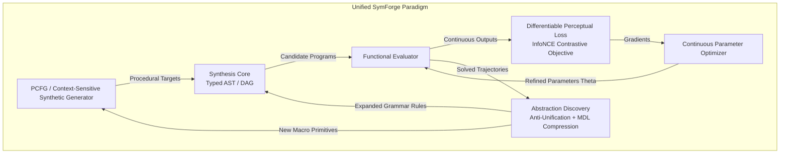
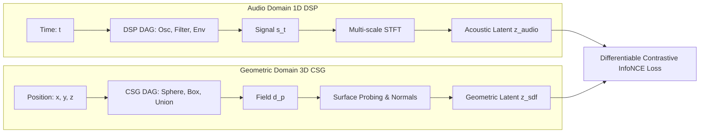
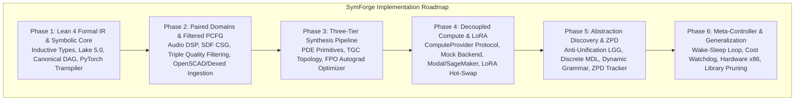

# Unified Neurosymbolic Synthesis Architecture: Audio, SDFs, and Generalization

## 1. Overview and Unifying Principle

**SymForge** is conceived as a universal neurosymbolic framework for the procedural synthesis of structured programs (Typed ASTs and DAGs), operating on a **fundamental isomorphism**: both audio synthesis (Digital Signal Processing - DSP) and implicit surface synthesis (Signed Distance Functions - SDFs) are concrete instances of the same mathematical problem:

> **Fundamental Problem:** Discover and parameterize a pure composition of known operators $f_{G, \Theta}: \mathcal{X} \to \mathcal{Y}$, guided by procedurally generated synthetic data and optimized by a **differentiable contrastive perceptual loss function**, promoting recurrent subgraphs into reusable, first-class abstractions.

```text
+---------------------------------------------------------------------------------------------------+
|                                  UNIFIED SYMFORGE PARADIGM                                        |
|                                                                                                   |
|  +--------------------+       +----------------------+       +---------------------------------+  |
|  |   PCFG / Context   | ----> |  Synthesis Core      | ----> | Differentiable Perceptual Loss  |  |
|  | Synthetic Generator|       |  (Typed AST / DAG)   |       |      (InfoNCE Contrastive)      |  |
|  +--------------------+       +----------+-----------+       +----------------+----------------+  |
|            ^                             |                                    |                   |
|            |                             v Discovered Subgraphs               v Gradients         |
|            |                  +----------+-----------+               +--------+-------+           |
|            +----------------- | Abstraction Engine   | <------------ |   Continuous   |           |
|             New Primitives    | (DreamCoder / MDL)   | Solved        |   Optimizer    |           |
|             in Grammar        +----------------------+ Trajectories  +----------------+           |
+---------------------------------------------------------------------------------------------------+
```



---

## 2. The Three Project Pillars

SymForge development is formally structured across three synergistic pillars:

### 2.1 Pillar 1: Audio Synthesizer (Procedural 1D DSP)
- **Coordinate Space:** $\mathcal{X} = \mathbb{R}$ (Continuous time $t$).
- **Output Space:** $\mathcal{Y} = [-1, 1]$ (Normalized audio pressure).
- **Known Base Primitives:**
  - *Generators / Oscillators:* `Sine(freq, phase)`, `Sawtooth(freq)`, `Square(freq, duty)`, `Triangle(freq)`, `Noise(seed)`.
  - *Modulators & Envelopes:* `ADSR(a, d, s, r)`, `ExpDecay(rate)`, `LFO(freq, shape)`, `FM(carrier, mod, index)`.
  - *Filters & Combinators:* `LowPass(cutoff, resonance)`, `HighPass(cutoff, resonance)`, `BandPass(center, q)`, `Gain(gain)`, `Mix(sig1, sig2, balance)`.
- **Perceptual Challenge:** Point-to-point sample errors ($L_1 / L_2$ in time domain) fail catastrophically: audibly identical signals with minor phase shifts produce maximal $L_2$ error.
- **Contrastive Perceptual Loss:** Multi-scale Short-Time Fourier Transform (STFT) log-magnitude representation projected into an acoustic latent space with InfoNCE contrastive separation against negative distractors.

### 2.2 Pillar 2: SDF Synthesizer (Implicit 3D Geometry)
- **Coordinate Space:** $\mathcal{X} = \mathbb{R}^d$ ($d=3$, spatial coordinates $\mathbf{p} = (x, y, z)$).
- **Output Space:** $\mathcal{Y} = \mathbb{R}$ (Signed euclidean distance to closest surface; $f(\mathbf{p}) < 0$ interior, $f(\mathbf{p}) > 0$ exterior).
- **Known Base Primitives:**
  - *Primitive Shapes:* `Sphere(radius)`, `Box(half_extents)`, `Cylinder(radius, height)`, `Torus(major_r, minor_r)`, `Plane(normal, offset)`.
  - *Spatial Transforms:* `Translate(sdf, offset)`, `Rotate(sdf, angles)`, `Scale(sdf, factor)`.
  - *CSG Combinators & Blends:* `Union(sdf1, sdf2)`, `Difference(sdf1, sdf2)`, `Intersection(sdf1, sdf2)`, `SmoothUnion(sdf1, sdf2, k)`.
- **Perceptual Challenge:** Deep interior points and distant exterior coordinates should not dominate gradients; human visual perception depends on surface contours, silhouettes, and normals.
- **Contrastive Perceptual Loss:** Stratified surface probing focused on the isosurface neighborhood ($\varepsilon$-boundary: $d(\mathbf{p}) \approx 0$) and normal cosine similarities contrasted against geometric distractors.

### 2.3 Pillar 3: Generalization (Universal Neurosymbolic Core)
The shared abstract core across all domains:
1. **Symbolic Data Structure:** Common typed IR supporting `Hole[T]`, topological derivation, and Common Subexpression Elimination (CSE) in canonical DAGs.
2. **Guided Search Engine:** Type-guided Beam Search and A* search informing $\mathbb{P}(\text{production} \mid \text{context})$.
3. **Procedural Generator:** Context-sensitive PCFGs sampling procedural tasks without human annotation.
4. **Abstraction Discovery (Library Learning):** Syntactic anti-unification (LGG) and Minimum Description Length (MDL) compression promoting recurrent subgraphs into first-class macros.
5. **Decoupled Training Dispatch:** Asynchronous delegation of LoRA fine-tuning to remote compute providers (Modal, SageMaker, Local Mock).

---

## 3. Unified Mathematical Formulation

```text
+---------------------------------------------------------------------------------------------------+
|                              ISOMORPHISM MATRIX: AUDIO vs. SDF                                    |
|                                                                                                   |
|  Concept                  Audio Synthesizer (1D DSP)             SDF Synthesizer (3D CSG)         |
|  -----------------------  -------------------------------------  -------------------------------- |
|  Spatial/Domain Input     t in R (Continuous Time)               p = (x,y,z) in R^3 (Coordinates) |
|  Continuous Output        s(t) in [-1, 1] (Acoustic Pressure)    d(p) in R (Signed Distance)      |
|  Composition / Boolean    Mix(s1, s2, w) / FM(carrier, mod)      Union / SmoothUnion(d1, d2, k)   |
|  Domain Transform         Time Delay / Frequency Modulation      Translation / Rotation / Scale   |
|  Perceptual Extractor     Multi-scale STFT Spectral Log-Mag      Surface Points / Normal Probes   |
|  Latent Contrast Space    Acoustic Embedding z_audio             Geometric Embedding z_sdf        |
+---------------------------------------------------------------------------------------------------+
```



### 3.1 Synthetic Data Generation via Context-Sensitive PCFG
To avoid dependence on external labeled datasets and exhaustively cover combinatorial program spaces, a procedural stochastic generator samples tasks:

$$\mathcal{G} = \langle V, \Sigma, R, S, \mathcal{P}_{\text{context}} \rangle$$

The probability of applying production rule $r: A \to \alpha$ depends on structural context and physical stability invariants:
1. **Audio Invariants:** Rejects unstable IIR filter poles ($|z| \ge 1.0$), digital clipping ($\max |s(t)| > 1.0$), and silent flat signals ($\max |s(t)| < 0.02$).
2. **SDF Invariants:** Enforces non-empty bounding box intersections, avoiding disjoint boolean operations (which produce zero gradients).

### 3.2 Differentiable Contrastive Perceptual Loss
Given a synthesized program $(G, \Theta)$ producing continuous function $\hat{f}$ and target reference $f^*$:

1. **Perceptual Embeddings:**
   A differentiable feature extractor $\Phi(\cdot)$ maps function outputs to a normalized latent vector $\mathbf{z} = \Phi(f) / \|\Phi(f)\|_2$:
   - For Audio: $\Phi_{\text{audio}}(s)$ computes log-magnitude STFT over multiple temporal window sizes (e.g. 512, 1024, 2048).
   - For SDF: $\Phi_{\text{sdf}}(d)$ samples distance values and surface normals $\mathbf{n} = \frac{\nabla d}{\|\nabla d\|_2}$ on stratified coordinate grids near $d(\mathbf{p}) \approx 0$.

2. **InfoNCE Contrastive Objective:**
   To anchor perceptual similarity against negative distractors $\{f^-_j\}_{j=1}^K$ with temperature $\tau$:

$$\mathcal{L}_{\text{contrast}} = -\log \frac{\exp\left(\frac{\mathbf{z}_{\hat{f}} \cdot \mathbf{z}_{f^*}}{\tau}\right)}{\exp\left(\frac{\mathbf{z}_{\hat{f}} \cdot \mathbf{z}_{f^*}}{\tau}\right) + \sum_{j=1}^{K} \exp\left(\frac{\mathbf{z}_{\hat{f}} \cdot \mathbf{z}_{f^-_j}}{\tau}\right)}$$

3. **Total Multi-Objective Loss:**
$$\mathcal{J}(G, \Theta) = \lambda_{\text{contrast}} \mathcal{L}_{\text{contrast}} + \lambda_{\text{rec}} \mathcal{L}_{\text{rec}}(\hat{f}, f^*) + \lambda_{\text{cost}} C_H(G)$$

Where $C_H(G)$ is the compiled hardware cost function computing FLOPs, memory footprint, and register pressure with deduction for DAG node reuse.

### 3.3 Abstraction Discovery and Library Learning
When recurrent subtrees emerge across solutions satisfying the perceptual threshold, they are abstracted into first-class typed macro-primitives:
1. **Anti-Unification:** Computes the Least General Generalization (LGG) between subgraphs $g_1, g_2$, parameterizing variable slots into `VariableNode`.
2. **Minimum Description Length (MDL):** Promotes the macro candidate if:
$$\Delta \text{MDL}(\alpha) = \text{Size}(\alpha) - \sum_{p \in \mathcal{D}_{\text{solved}}} \left( \text{Size}(p) - \text{Size}(p[\alpha]) \right) < 0$$
3. **Dynamic Grammar Injection:** The macro is registered with prior probability $\mathbb{P}(\alpha) > 0$, enabling the synthesizer to construct deeper programs within strict search step budgets.

---

## 4. Implementation Phases

```text
+----------------------------------------------------------------------------------------------------+
|                                    SYMFORGE PHASE ROADMAP                                          |
|                                                                                                    |
|  PHASE 1: LEAN 4 FORMAL IR & SYMBOLIC CORE                                                         |
|  - Inductive grammar definitions in Lean 4 (symforge_ir) with verified theorems.                   |
|  - Typed AST / Canonical hash-consed DAG with Common Subexpression Elimination.                    |
|  - Metaprogrammed transpiler emitting PyTorch DifferentiableModule graphs with autograd.           |
|  - Baseline PCFG generator and InfoNCE contrastive loss engine.                                    |
|                                                                                                    |
|  PHASE 2: PAIRED DOMAINS & TRIPLE-FILTERED PCFG                                                    |
|  - Audio 1D DSP primitives and multi-scale STFT feature extractor.                                 |
|  - SDF 3D CSG primitives, affine transforms, and surface raymarching probe.                         |
|  - Triple Quality Filtering (Physical Validity, Perceptual Entropy, DAG Deduplication).           |
|  - OpenSCAD & Dexed normalizers and supervised production tuple harvester.                        |
|                                                                                                    |
|  PHASE 3: THREE-TIER NEUROSYMBOLIC PIPELINE (PDE -> TGC -> FPO)                                    |
|  - Model 1 (PDE): Primitive & Depth Estimator (F1 >= 95%, 0.23ms CPU).                             |
|  - Model 2 (TGC): Type-constrained structural assembler (0.38ms CPU).                              |
|  - Model 3 (FPO): Differentiable continuous parameter optimizer (<= 30 steps, autograd).           |
|  - Complexity curriculum benchmark comparing Audio vs SDF learning dynamics.                      |
|                                                                                                    |
|  PHASE 4: DECOUPLED COMPUTE PROVIDER & LORA LAYER                                                  |
|  - Asynchronous ComputeProvider protocol and strict Pydantic v2 contracts.                         |
|  - MockComputeProvider (< 10ms, $0.00 USD) for local CI/CD.                                       |
|  - Resilient Modal & AWS SageMaker remote providers (timeouts, jitter, loop bounds).               |
|  - Modular LoRA adapter registry with dynamic CPU hot-swapping in 0.47ms (< 15MB).                 |
|                                                                                                    |
|  PHASE 5: DREAMCODER ABSTRACTION DISCOVERY & ZPD CURRICULUM                                        |
|  - First-order syntactic anti-unification (LGG in < 15ms).                                         |
|  - Discrete MDL compression evaluator (Delta MDL < 0).                                             |
|  - Dynamic Lean 4 grammar expander & PCFG prior renormalizer (> 64% search step reduction).        |
|  - Competency frontier tracker in the Zone of Proximal Development (0.2 <= S(c) <= 0.8).          |
|                                                                                                    |
|  PHASE 6: META-CONTROLLER, GENERALIZATION & RESILIENCE                                             |
|  - Wake-sleep meta-controller loop with non-blocking double-buffering.                             |
|  - Financial Pre-Flight Cost Watchdog ($2.00 hard cap + 25% safety buffer).                        |
|  - Cross-domain benchmark: Audio, SDF, and Hardware Superoptimization (x86 BHive basic blocks).    |
|  - Library bloat pruner with safe leaf inlining and offline circuit breaker queue.                 |
+----------------------------------------------------------------------------------------------------+
```


