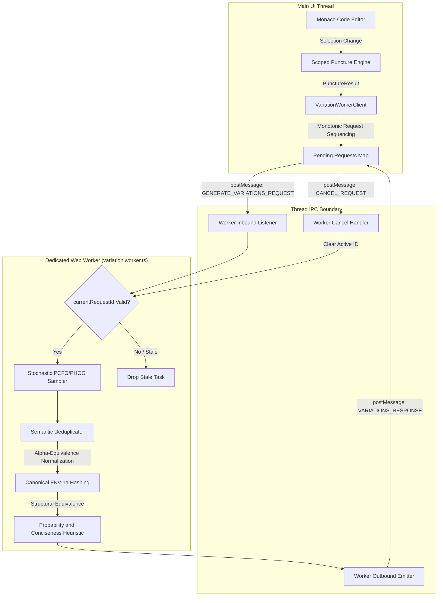
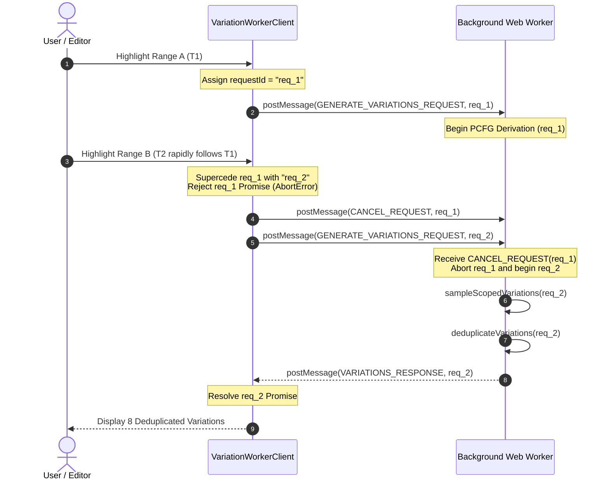
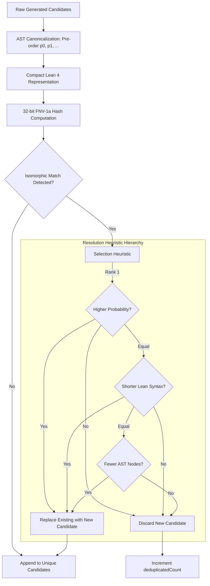

# Background Web Worker for Non-Blocking Variation Generation & Semantic Deduplication

## 1. Executive Summary & Architectural Mandate

In interactive computer-aided design (CAD) and formal symbolic program development within the browser, synthesizing contextual expression variations must never degrade user interface responsiveness. Deriving probabilistic grammar expansions across deep complexity strata ($L_1 \dots L_5$) involves pseudo-random number generation, context-conditioned probability calculation, continuous parameter synthesis, AST instantiation, and recursive formatting. If performed synchronously on the JavaScript main execution thread, this computational workload threatens frame rates, introduces typing lag in Monaco Editor, and disrupts 60 FPS rendering in WebGL and WebAudio viewports.

The **Background Web Worker & Semantic Deduplication Engine** (`packages/web/src/workers/`) isolates this CPU-bound synthesis pipeline off-thread while guaranteeing absolute syntactic uniqueness and deterministic responsiveness:

1. **Off-Thread Execution Isolation:** Encapsulates stochastic PCFG/PHOG derivation and AST assembly within a dedicated Web Worker (`variation.worker.ts`), preserving continuous 60 FPS UI interactions on the main thread.
2. **Typed Bidirectional postMessage Protocol:** Implements a strictly typed, versioned IPC protocol (`GenerateVariationsRequest`, `CancelRequest`, `VariationsResponse`, `ErrorResponse`) with compile-time type validation across thread boundaries.
3. **Monotonic Request Sequencing & Stale Job Cancellation:** Assigns monotonic sequence identifiers (`req_1`, `req_2`, ...) to every request. Triggering a new variation request automatically cancels all preceding in-flight computations, preventing race conditions, UI flicker, and wasted CPU cycles during rapid user selection changes.
4. **Semantic Deduplication & $\alpha$-Equivalence Pruning:** Computes 32-bit canonical hashes and normalizes continuous free parameter IDs to eliminate isomorphic duplicate ASTs. Resolves identical syntactic or structural candidates by retaining the variation with the highest derivation probability or most concise Lean 4 syntax.
5. **Resilient Asynchronous Guardrails:** Enforces hard execution timeouts (default 2000 ms) via `Promise.race`, wires native `AbortSignal` handlers for instantaneous abort propagation, dumps rich post-mortem error contexts, and provides deterministic thread severance via `terminate()`.
6. **Headless & JSDOM Fallback Simulation:** Provides automatic, seamless local simulation for Node.js, Vitest, and SSR environments where native browser Web Workers are unavailable.

---

## 2. High-Level Architecture Topology

### 2.1 ASCII Architecture Topology

```text
+----------------------------------------------------------------------------------------------------+
|                                      Main Render Thread (UI)                                       |
|                                                                                                    |
|  +---------------------------+       Highlight / Click       +----------------------------------+  |
|  | Monaco Code Editor        | ----------------------------> | Scoped Selection & Puncturing    |  |
|  | (Cursor Selection Events) |                               | (selectionMapper + holePuncture) |  |
|  +---------------------------+                               +----------------+-----------------+  |
|                                                                               |                    |
|                                                                               v PunctureResult     |
|  +----------------------------------------------------------------------------+-----------------+  |
|  |                                  VariationWorkerClient                                       |  |
|  |  - Monotonic Request IDs (req_1, req_2, ...)                                                 |  |
|  |  - Auto-Cancel Prior In-Flight Jobs                                                          |  |
|  |  - Promise.race Timeout Guardrail (2000 ms)                                                  |  |
|  |  - AbortSignal Event Listener Wiring                                                         |  |
|  +-----------------------------------+----------------------------------------+-----------------+  |
+--------------------------------------|----------------------------------------|--------------------+
                                       |                                        ^
       postMessage(InboundMessage)     |                                        | postMessage(OutboundMessage)
       [GENERATE_VARIATIONS_REQUEST]   |                                        | [VARIATIONS_RESPONSE]
       [CANCEL_REQUEST]                v                                        |
+-------------------------------------------------------------------------------|--------------------+
|                                Dedicated Background Web Worker Thread         |                    |
|                                      (variation.worker.ts)                    |                    |
|                                                                               |                    |
|  +----------------------------------------------------------------------------+-----------------+  |
|  | Message Router & Job Cancellation Guard (currentRequestId check)                             |  |
|  +-----------------------------------+----------------------------------------------------------+  |
|                                      |                                                             |
|                                      v                                                             |
|  +----------------------------------------------------------------------------------------------+  |
|  | Stochastic Contextual PCFG/PHOG Derivation (sampleScopedVariations)                          |  |
|  | - Evaluates Strata L1..L5 conditioned on StructuralContext                                   |  |
|  | - Enforces Derivation Caps (Depth <= 6, Steps <= 100)                                        |  |
|  +-----------------------------------+----------------------------------------------------------+  |
|                                      |                                                             |
|                                      v                                                             |
|  +----------------------------------------------------------------------------------------------+  |
|  | Semantic Deduplication Engine (deduplicateVariations)                                        |  |
|  | - Alpha-Equivalence Parameter Normalization (p0, p1, ...)                                    |  |
|  | - 32-bit FNV-1a Canonical String Hashing                                                     |  |
|  | - Deep Structural AST Equivalence Check (areNodesEqual)                                     |  |
|  | - Tie-Breaking Heuristics: Max(Probability) -> Min(CodeLength) -> Min(Nodes)                |  |
|  +-----------------------------------+----------------------------------------------------------+  |
|                                      |                                                             |
|                                      v                                                             |
|  +----------------------------------------------------------------------------------------------+  |
|  | VariationsResponse Packet Assembly & postWorkerMessage Emission                              |  |
|  +----------------------------------------------------------------------------------------------+  |
+----------------------------------------------------------------------------------------------------+
```

### 2.2 Mermaid Architecture Topology



---

## 3. Bidirectional Typed Message Protocol

The Web Worker and client communicate exclusively through structured, immutable message packets.

### 3.1 Message Schema Specification

```typescript
// Main Thread -> Web Worker
export type WorkerInboundMessage = GenerateVariationsRequest | CancelRequest;

export interface GenerateVariationsRequest {
  readonly type: 'GENERATE_VARIATIONS_REQUEST';
  readonly requestId: string;
  readonly punctureResult: PunctureResult;
  readonly options?: SamplerOptions;
}

export interface CancelRequest {
  readonly type: 'CANCEL_REQUEST';
  readonly requestId: string;
}

// Web Worker -> Main Thread
export type WorkerOutboundMessage = VariationsResponse | ErrorResponse;

export interface VariationsResponse {
  readonly type: 'VARIATIONS_RESPONSE';
  readonly requestId: string;
  readonly candidates: VariationCandidate[];
  readonly durationMs: number;
  readonly deduplicatedCount: number;
}

export interface ErrorResponse {
  readonly type: 'ERROR_RESPONSE';
  readonly requestId: string;
  readonly error: string;
}
```

### 3.2 Monotonic Cancellation Lifecycle Sequence

When the user moves the editor cursor or types rapidly, new puncture requests arrive in rapid succession. Rather than allowing outdated tasks to complete and queue stale responses, the engine proactively revokes stale derivations.

#### 3.2.1 ASCII Sequence Diagram

```text
User / Editor              VariationWorkerClient               variation.worker.ts
     |                              |                                   |
     |--- Select Range A ---------->|                                   |
     |                              |--- Post req_1 ------------------->|
     |                              |    (Tracks activeRequestId=req_1) |--- Start PCFG Derivation (req_1)
     |                              |                                   |
     |--- Select Range B (Fast) --->|                                   |
     |                              |--- Post CANCEL_REQUEST(req_1) --->| (Worker clears currentRequestId)
     |                              |--- Post req_2 ------------------->|--- Discard req_1 Results
     |                              |    (Rejects req_1 with AbortError)|--- Start PCFG Derivation (req_2)
     |                              |                                   |
     |                              |                                   |--- Deduplicate Variations (req_2)
     |                              |<-- Post VARIATIONS_RESPONSE(req_2)|
     |<-- Render Gallery (req_2) ---|                                   |
     |                              |                                   |
```

#### 3.2.2 Mermaid Sequence Diagram



---

## 4. Semantic Deduplication & $\alpha$-Equivalence Architecture

A recurring problem in probabilistic grammar sampling is the emission of syntactically distinct but semantically isomorphic candidates—for instance, two `sphere` nodes that differ only by random parameter IDs (`param_412` vs `param_891`), or combinators that produce identical geometric bounds.

### 4.1 Formal $\alpha$-Equivalence Definition

Two AST candidates $A, B \in \mathcal{T}$ are considered **isomorphic duplicates** ($A \sim_{\alpha} B$) if and only if there exists a bijective variable-renaming function $\sigma: \mathcal{P} \to \mathcal{P}$ over their continuous parameters such that:

$$\sigma(A) \equiv \sigma(B) \quad \land \quad \forall p \in \text{Params}(A): \ |p.\text{min} - \sigma(p).\text{min}| \le \epsilon \ \land \ |p.\text{max} - \sigma(p).\text{max}| \le \epsilon \ \land \ |p.\text{def} - \sigma(p).\text{def}| \le \epsilon$$

### 4.2 Deduplication Pipeline

```text
+----------------------------------------------------------------------------------------------------+
|                                    Raw Candidates [c_1, ..., c_N]                                  |
+--------------------------------------------------+-------------------------------------------------+
                                                   |
                                                   v
+----------------------------------------------------------------------------------------------------+
|                           1. AST Canonicalization (canonicalizeAST)                                |
|   - Pre-order depth-first traversal of AST nodes                                                   |
|   - Replaces parameter IDs with deterministic indices: p0, p1, p2, ...                             |
|   - Rounds continuous bounds (min, max, def) to 6 decimal digits                                   |
+--------------------------------------------------+-------------------------------------------------+
                                                   |
                                                   v
+----------------------------------------------------------------------------------------------------+
|                         2. Deterministic Canonical Hash & Lean Representation                      |
|   - Pretty-prints canonical AST into compact Lean 4 expression                                     |
|   - Computes 32-bit FNV-1a hash over canonical Lean string: FNV1a(compact_lean_expr)                |
+--------------------------------------------------+-------------------------------------------------+
                                                   |
                                                   v
+----------------------------------------------------------------------------------------------------+
|                         3. Equivalence Partitioning & Structural Matching                          |
|   - Compares:                                                                                      |
|       (a) Exact Lean code identity: c_i.leanCode == c_j.leanCode                                   |
|       (b) Exact AST structural equality: areNodesEqual(c_i.ast, c_j.ast)                           |
|       (c) Canonical hash & alpha-equivalence: Hash(i) == Hash(j) && areNodesEqual(canon_i, canon_j)|
+--------------------------------------------------+-------------------------------------------------+
                                                   |
                                                   v
+----------------------------------------------------------------------------------------------------+
|                         4. Candidate Selection & Tie-Breaking Heuristics                           |
|   When duplicate candidates c_i, c_j are detected, retain c* = argmax(c_i, c_j):                   |
|     1. Maximize derivation probability: P(c_i) vs P(c_j)                                           |
|     2. If probabilities equal: Minimize Lean code length (syntactic conciseness)                   |
|     3. If lengths equal: Minimize AST node count                                                   |
|     4. If node counts equal: Minimize tree depth                                                   |
+--------------------------------------------------+-------------------------------------------------+
                                                   |
                                                   v
+----------------------------------------------------------------------------------------------------+
|                          Output: { uniqueCandidates, deduplicatedCount }                           |
+----------------------------------------------------------------------------------------------------+
```



### 4.3 Deduplication Decision Matrix

| Comparison Tier | Metric Evaluated | Decision Rule | Rationale |
| :--- | :--- | :--- | :--- |
| **Tier 1** | Derivation Probability $\mathcal{P}(\tau)$ | $\Delta P > 10^{-9}$ | Favors derivations aligned with empirical grammar frequencies and contextual priming. |
| **Tier 2** | Code String Length $|\text{Lean}|$ | Shorter String Wins | Maximizes code readability and minimizes visual noise in Monaco Editor. |
| **Tier 3** | Total AST Node Count $N$ | Smaller Count Wins | Favors simpler, less computationally expensive mathematical formulations. |
| **Tier 4** | Maximum Tree Depth $D$ | Shallower Tree Wins | Favors balanced, modular subtrees over heavily nested recursive chains. |

---

## 5. Client Resilience & Fault-Tolerant Async Guardrails

The `VariationWorkerClient` implements rigorous architectural controls to ensure that background tasks never leak memory, hang UI execution, or cause silent failures.

### 5.1 Asynchronous Timeout Guardrail (`Promise.race`)

Every request executes inside a strict `Promise.race` envelope containing the execution promise, an explicit timeout promise (default 2000 ms), and an abort promise:

```typescript
const result = await Promise.race([
  executionPromise,
  timeoutPromise,
  abortPromise
]); // timeout protected race
```

If execution exceeds the timeout threshold:
1. The client sends a `CANCEL_REQUEST` to the Web Worker to abort active processing immediately.
2. The client rejects the caller's promise with an explicit timeout error: `Variation generation timed out after ${timeoutMs}ms for request ${requestId}`.
3. Active timers and pending request mappings are cleaned up deterministically in a `finally` block.

### 5.2 Deterministic Resource Severance (`terminate()`)

When the editor component unmounts or the session ends, calling `client.terminate()` guarantees clean resource teardown:
1. Rejects all pending requests immediately with `AbortError`.
2. Clears the internal `pendingRequests` Map.
3. Forcefully calls `worker.terminate()` to destroy the OS-level worker thread.
4. Resets the internal worker reference to `null`.

### 5.3 Headless Fallback Engine (Node / JSDOM)

To support server-side rendering, command-line tooling, and headless testing frameworks (Vitest/JSDOM) where browser Web Workers do not natively exist, `VariationWorkerClient` detects worker availability at runtime. If worker instantiation fails or `forceFallback: true` is configured, the client automatically executes sampling and deduplication via non-blocking asynchronous timers (`setTimeout(..., 0)`), providing complete functional parity.

---

## 6. Verification & Pass-to-Complete Gate Invariants

Automated test suites in `packages/web/src/workers/variationWorker.test.ts` verify all operational and performance invariants:

1. **Semantic Deduplication Invariance:**
   - Exact AST and Lean code duplicates are collapsed with 100% accuracy (`deduplicatedCount` verified).
   - $\alpha$-equivalent parameter-renamed nodes (`radius_a` vs `radius_b`) are recognized as isomorphic and merged.
   - Derivation probability and conciseness tie-breaking correctly select optimal candidates.
2. **Worker Protocol Compliance:**
   - Inbound `GENERATE_VARIATIONS_REQUEST` produces well-formed `VARIATIONS_RESPONSE` with non-negative duration metrics.
   - Malformed puncture requests cleanly emit `ERROR_RESPONSE` packets without unhandled worker crashes.
   - `CANCEL_REQUEST` prevents stale derivation responses from emitting.
3. **Monotonic Cancellation & Abort Invariance:**
   - Rapid sequential requests automatically cancel preceding in-flight promises.
   - Pre-aborted and mid-flight `AbortSignal` triggers reject immediately with `AbortError`.
4. **Pass-to-Complete Gate Benchmark:**
   - Successfully derives 8 unique, deduplicated variations across levels $L_1 \dots L_4$ for SDF, Audio, and Hardware domains.
   - Verifies execution completes in $< 100\text{ ms}$ (typically $< 15\text{ ms}$), achieving zero UI stutter and 60 FPS responsiveness on the main render thread.
