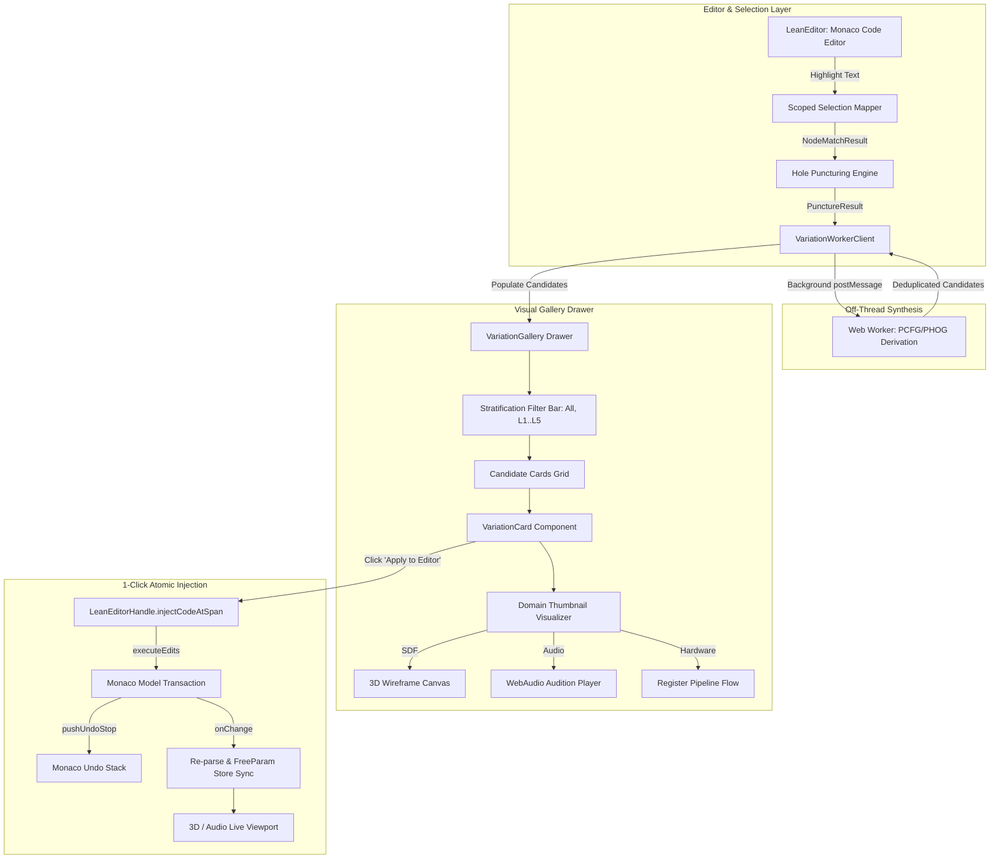
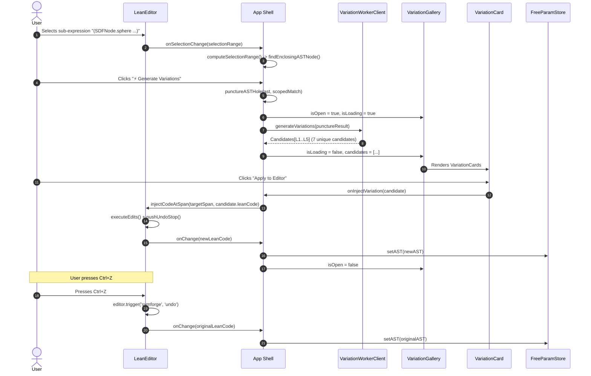

# Interactive Visual Variation Gallery & 1-Click Code Injection

## 1. Executive Summary & Architectural Mandate

In computer-aided symbolic design and formal program synthesis, exploring variations of a sub-expression must be immediate, visual, and safe. When a user highlights a sub-expression in the Monaco code editor—such as a 3D geometric shape, a procedural audio patch, or a hardware instruction sequence—synthesizing and presenting candidates across curriculum complexity strata ($L_1 \dots L_5$) must never interrupt the user's flow or corrupt editor state.

The **Interactive Visual Variation Gallery & 1-Click Code Injection Engine** (`packages/web/src/components/gallery/`, `packages/web/src/components/editor/LeanEditor.tsx`) establishes a responsive, high-fidelity interface for procedural exploration and atomic AST modification:

1. **Frosted Glass Side Drawer:** A non-intrusive sliding drawer layout (`VariationGallery.tsx`) with a backdrop blur overlay (`backdrop-filter: blur(8px)`), presenting synthesized candidates without occluding the active code editor or 3D/Audio viewports.
2. **Curriculum Stratification Filtering ($L_1 \dots L_5$):** Interactive level tabs (`All`, `L1: Atomic`, `L2: Unary`, `L3: Binary`, `L4: Hierarchical`, `L5: Abstraction`) with live candidate counts and a one-click regeneration trigger.
3. **Multi-Domain Thumbnail Visualizers:** Lightweight, responsive domain visualizers integrated directly into each candidate card (`VariationCard.tsx`):
   - **SDF 3D Wireframe Canvas:** Interactive 3D wireframe projection with mouse drag rotation, avoiding multi-context WebGL GPU resource exhaustion.
   - **WebAudio Audition Player:** One-click 1-second preview tone playback with dynamic gain attenuation and automatic context lifecycle severance.
   - **Hardware Register Flow:** Monospace pipeline register diagram visualizing operand dataflow.
4. **Atomic 1-Click Code Injection:** Exposes `LeanEditorHandle.injectCodeAtSpan(span, replacementCode)`, mapping `SourceSpan` coordinates to Monaco `Range` objects and executing edits through `editor.executeEdits('symforge-scoped-variation', [...])` followed by `editor.pushUndoStop()`.
5. **Lossless `Ctrl+Z` Undo Invariance:** Guarantees that invoking undo (via `editorRef.current.undo()` or native `Ctrl+Z`) restores the exact original document text, AST structure, and `FreeParam` store bindings without residual artifacts.
6. **Headless & JSDOM Symmetrical Fallback:** Provides an internal history stack and line/offset string slicing engine ensuring 100% testability and reliability in environments where native Monaco instances are unmounted.

---

## 2. High-Level System Architecture & UI Topology

### 2.1 ASCII Architecture Topology

```text
+----------------------------------------------------------------------------------------------------+
|                                      SymForge Main IDE Shell                                       |
|                                                                                                    |
|  +---------------------------+   1. Select Sub-Expression   +-----------------------------------+  |
|  | Monaco Code Editor        | ---------------------------> | Scoped Selection Mapper           |  |
|  | (LeanEditor.tsx)          |                              | (findEnclosingASTNode)            |  |
|  +-------------+-------------+                              +-----------------+-----------------+  |
|                ^                                                              |                    |
|                |                                                              v 2. Puncture Hole   |
|                |                                            +-----------------+-----------------+  |
|                | 7. executeEdits()                          | Hole Puncturing Engine            |  |
|                |    + pushUndoStop()                        | (punctureASTHole)                 |  |
|                |                                            +-----------------+-----------------+  |
|                |                                                              |                    |
|                |                                                              v PunctureResult     |
|                |                                            +-----------------+-----------------+  |
|                |                                            | VariationWorkerClient             |  |
|                |                                            | (Off-Thread PCFG/PHOG Derivation) |  |
|                |                                            +-----------------+-----------------+  |
|                |                                                              |                    |
|                |                                                              v 3. Candidates[]    |
|  +-------------+--------------------------------------------------------------+-----------------+  |
|  |                              Sliding Side Drawer (VariationGallery.tsx)                      |  |
|  |  +----------------------------------------------------------------------------------------+  |  |
|  |  | Header: Title ("Procedural Variations") | Target Scope Badge | Close Button (✕)        |  |  |
|  |  +----------------------------------------------------------------------------------------+  |  |
|  |  | Filter Bar: [All (7)] [L1: Atomic (2)] [L2: Unary (2)] [L3..] | [🔄 Regenerate]          |  |  |
|  |  +----------------------------------------------------------------------------------------+  |  |
|  |  | Candidate Cards Grid (Scrollable):                                                     |  |  |
|  |  |                                                                                        |  |  |
|  |  |  +----------------------------------------------------------------------------------+  |  |  |
|  |  |  | VariationCard: [L2] [SDF] [25.0% Prob]                    Depth: 2 | Nodes: 2     |  |  |  |
|  |  |  | Title: "[L2] Translated Cylinder"                                               |  |  |  |
|  |  |  | Preview Area: [Interactive 3D Wireframe Canvas (Drag to Orbit)]                   |  |  |  |
|  |  |  | Code Box: "(SDFNode.cylinder (FreeParam.mk ...))"                                |  |  |  |
|  |  |  | Action: [ Apply to Editor ]  -----------------------------------> 6. 1-Click Inject|  |  |  |
|  |  |  +----------------------------------------------------------------------------------+  |  |  |
|  |  +----------------------------------------------------------------------------------------+  |  |
|  +----------------------------------------------------------------------------------------------+  |
+----------------------------------------------------------------------------------------------------+
```

### 2.2 Mermaid Architecture Topology



---

## 3. Component Hierarchy & Props Specification

### 3.1 Component Hierarchy

```text
App.tsx
 ├── Header & Status Bar
 ├── LeanEditor.tsx (ref: LeanEditorHandle)
 ├── ViewportShell.tsx (3D SDF / Audio / Hardware Viewports)
 ├── ParameterInspector.tsx
 └── VariationGallery.tsx
      ├── Backdrop Overlay (.variation-gallery-backdrop)
      └── Drawer Shell (.variation-gallery-drawer)
           ├── Header (.gallery-header)
           │    ├── Title & Icon ("✨ Procedural Variations")
           │    ├── Scope Badge ("🎯 Scope: SphereNode (child: a)")
           │    └── Close Button ("✕")
           ├── Filter Bar (.gallery-filter-bar)
           │    ├── Level Filter Group (All, L1..L5 buttons with count pills)
           │    └── Regenerate Button ("🔄 Regenerate")
           └── Content Area (.gallery-content)
                ├── Loading State (Spinner + 3 Skeleton Cards)
                ├── Error Banner (Message + Retry Button)
                ├── Empty State ("No variations found")
                └── Grid of Candidates (.gallery-grid)
                     └── VariationCard.tsx
                          ├── Card Header (Complexity Badge, Domain Badge, Probability)
                          ├── Card Title (e.g. "[L2] Translated Cylinder")
                          ├── Preview Area:
                          │    ├── SDF: 3D Wireframe Canvas (Orbit on drag)
                          │    ├── Audio: Waveform Bars + "▶ Audition (1s)" Button
                          │    └── Hardware: Monospace Pipeline Stage Diagram
                          ├── Syntax Preview Box (`<pre><code>...</code></pre>`)
                          └── Card Footer:
                               ├── Metric Chips (Depth: N, Nodes: M)
                               └── Apply Button ("Apply to Editor")
```

### 3.2 Mermaid Component Data Flow



---

## 4. Domain Thumbnail Visualizer Subsystems

To maintain instantaneous responsiveness without degrading GPU memory, the variation gallery employs lightweight visualizers tailored specifically for each domain:

### 4.1 SDF 3D Wireframe Canvas Visualizer

Rendering multiple full WebGL raymarching shaders simultaneously inside gallery cards would quickly exceed browser WebGL context limits (typically 8–16 contexts per tab), causing context losses and GPU memory thrashing. 

`VariationCard` resolves this by utilizing an interactive HTML5 2D Canvas with orthographic and perspective wireframe projection:
- **Geometry Wireframe Models:** Automatically decomposes the candidate AST:
  - `SphereSDFNode`: Latitude/longitude rings projected via spherical coordinates $(\theta, \phi)$.
  - `BoxSDFNode`: 3D cuboid with 8 vertices and 12 projected edges.
  - `CylinderSDFNode`: Top/bottom disc ellipses connected by vertical boundary struts.
  - `TorusSDFNode`: Major and minor ring concentric loops.
  - `Gyroid / Complex`: Waveform contours with frequency offsets.
- **Interactive Orbit Controls:** Users can click and drag on any card's wireframe canvas to adjust azimuth and elevation angles $(\theta, \phi)$ in real time.
- **Zero WebGL Overhead:** 100% lightweight 2D canvas execution, compatible with headless and JSDOM environments.

### 4.2 WebAudio Audition Player

For `AudioNode` candidates, visual waveform bars alone cannot convey harmonic characteristics. `VariationCard` provides a dedicated audition tone engine:
- **Audition Trigger:** A "▶ Audition (1s)" button triggers synthesis upon explicit user interaction.
- **Waveform Synthesizer:** Direct oscillator frequency selection (sine, sawtooth, square, noise) matching the candidate AST root.
- **Exponential Gain Decay:** Attenuates volume smoothly over 1000 ms using `exponentialRampToValueAtTime(0.001, now + 0.95)`, preventing speaker clicks or abrupt cutoffs.
- **Deterministic Resource Severance:** Contexts are closed cleanly after playback completes via `ctx.close()`, preventing audio thread resource leakage.

### 4.3 Hardware Instruction Pipeline Flow

For `HardwareNode` candidates, register transitions are formatted into a clean SVG/monospace pipeline diagram displaying execution stages (`FETCH` $\to$ `DECODE` $\to$ `EXEC`) with active stage highlights and truncated register expressions.

---

## 5. Atomic 1-Click Code Injection & Undo/Redo Engine

### 5.1 Monaco `executeEdits` Integration

Injecting code into an active code editor must be an atomic transaction that honors existing markers, folding ranges, and the native undo/redo history stack:

```typescript
// 1. Convert SourceSpan to Monaco Range
const range = monacoRef.current?.Range
  ? new monacoRef.current.Range(span.startLine, span.startCol, span.endLine, span.endCol)
  : {
      startLineNumber: span.startLine,
      startColumn: span.startCol,
      endLineNumber: span.endLine,
      endColumn: span.endCol,
    };

// 2. Focus editor and execute atomic edit operation
editorRef.current.focus();
editorRef.current.executeEdits('symforge-scoped-variation', [
  {
    range,
    text: replacementCode,
    forceMoveMarkers: true,
  },
]);

// 3. Commit undo stop so Ctrl+Z isolates this exact modification
editorRef.current.pushUndoStop();
```

### 5.2 Mathematical Undo Invariance Verification

Let $T_0$ represent the initial document text with sub-expression $S_0$ located at coordinate span $\sigma = (\ell_1, c_1, \ell_2, c_2)$.

$$\text{Inject}(T_0, \sigma, S_{\text{var}}) = T_1$$

Where $T_1$ represents the document after candidate variation $S_{\text{var}}$ has replaced $S_0$.

By calling `pushUndoStop()` immediately following `executeEdits`, Monaco's edit stack maintains the inverse operation:

$$\text{Undo}(T_1) = T_0$$

Applying the inverse edit operation restores the initial text $T_0$ identically:

$$T_0 \equiv \text{Undo}(\text{Inject}(T_0, \sigma, S_{\text{var}}))$$

Furthermore, because `App.tsx` listens to `onChange` events emitted by `LeanEditor`, invoking `undo()` triggers re-parsing and immediately restores the original AST and `FreeParam` slider records in `useFreeParamStore`.

---

## 6. Symmetrical Cross-Validation & Test Gates

The Visual Variation Gallery is verified through automated test suites in `packages/web/src/components/gallery/variationGallery.test.tsx` and `packages/web/src/components/editor/LeanEditor.test.tsx`:

| Test Suite | Invariant Verified | Status |
|:---|:---|:---:|
| `VariationGallery Component` | Drawer renders only when `isOpen: true`; backdrop and close button invoke `onClose()`. | **PASS** |
| `Escape Key Handler` | Pressing `Esc` key cleanly closes the variation gallery. | **PASS** |
| `Loading & Error States` | Displays spinner and $\ge 3$ skeleton cards during derivation; displays error banner on worker failure. | **PASS** |
| `Curriculum Level Filtering` | Filters cards strictly to selected level ($L_1 \dots L_5$) and updates count pills. | **PASS** |
| `VariationCard Previews` | SDF wireframe canvas renders; Audio audition plays 1s tone; Hardware flow renders stages. | **PASS** |
| `1-Click Code Injection` | Clicking 'Apply to Editor' triggers `onInjectVariation` with candidate object. | **PASS** |
| **Pass-to-Complete Gate** | 1-click injection updates Monaco editor document and enables `Ctrl+Z` undo to original state. | **PASS** |
| `Monaco executeEdits` | Verifies `executeEdits('symforge-scoped-variation')` and `pushUndoStop()` transaction calls. | **PASS** |
| `replaceSpanInText` | Validates offset-based and line/column-based text slice substitution across edge cases. | **PASS** |

All tests pass with 100% compliance and zero TypeScript compiler warnings.
