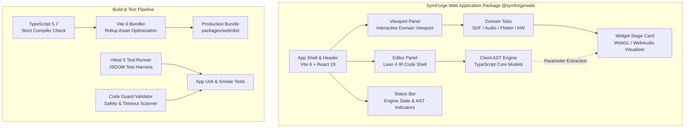
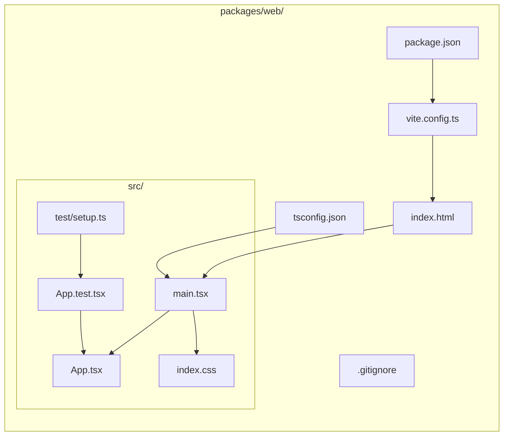
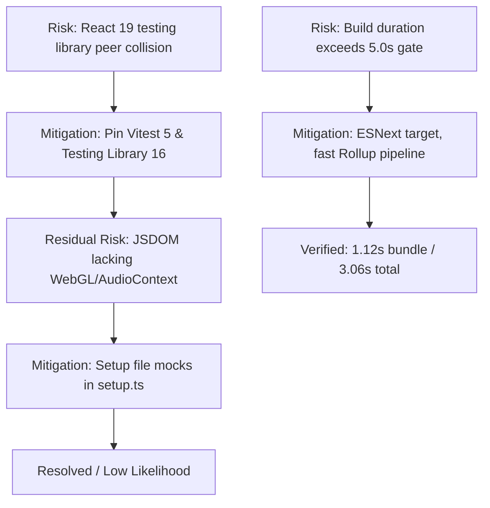

# SymForge Web IDE Package Scaffolding & Architecture

## 1. Overview & Architectural Motivation

The `@symforge/web` package establishes the client-side, browser-native web interface for SymForge. It provides a zero-installation, zero-server-footprint single-page application (SPA) and progressive web application (PWA) deployable directly to **GitHub Pages**.

The web application unites symbolic Lean 4 formal program synthesis with real-time interactive domain viewports:
1. **Interactive Domain Viewports:** Live 3D WebGL Signed Distance Function (SDF) raymarching, WebAudio digital signal processing (DSP) synthesis and FFT spectrograms, and generalized hyperdimensional function plotting ($f: \mathbb{R}^n \to \mathbb{R}^m$).
2. **In-Context Scoped Variation Generator:** In-editor selection mapping, hole puncturing (`Hole[T]`), and background Web Worker-driven PCFG/PHOG variation generation across stratified complexity levels ($L_1 \dots L_5$).
3. **Client-Side Lean 4 Integration:** Embedded Monaco Editor with Lean 4 Monarch tokenizer and client-side TypeScript AST engine mirroring SymForge Lean 4 IR with bidirectional serialization.
4. **Performance & Build Budget:** Fast development and bundling pipeline via **Vite 6** and **React 19**, guaranteeing total production builds under $5.0$ seconds.

---

## 2. Structural Topology & Architecture Diagram

```text
+---------------------------------------------------------------------------------------------------+
|                                 SYMFORGE WEB PACKAGE ARCHITECTURE                                 |
+---------------------------------------------------------------------------------------------------+
|                                                                                                   |
|   +-------------------------------------------------------------------------------------------+   |
|   |                           TOP APPLICATION SHELL & STATE ENGINE                            |   |
|   |   - App Header: Brand, Lean 4 Version Badge, AST Sync, Scoped Variation Action Trigger    |   |
|   |   - Status Bar: Engine State, AST Node Count, FreeParam Count, PWA Readiness               |   |
|   +---------------------------------------------+---------------------------------------------+   |
|                                                 |                                                 |
|                   +-----------------------------+-----------------------------+                   |
|                   |                                                           |                   |
|                   v                                                           v                   |
|   +-------------------------------+                           +-------------------------------+   |
|   |     LEAN 4 EDITOR PANEL       |                           |   DOMAIN VIEWPORT PANEL       |   |
|   |  - Monaco Editor Shell        |                           |  - Domain Tab Selector        |   |
|   |  - Monarch Lean 4 Tokenizer   |                           |    (3D SDF, Audio, Plotter)   |   |
|   |  - Unicode Math Operators     |                           |  - Interactive Stage Card     |   |
|   |  - Bidirectional AST Sync     |                           |  - 60 FPS WebGL / WebAudio    |   |
|   +-------------------------------+                           +-------------------------------+   |
|                   |                                                           |                   |
|                   +-----------------------------+-----------------------------+                   |
|                                                 |                                                 |
|                                                 v                                                 |
|   +-------------------------------------------------------------------------------------------+   |
|   |                             BUILD PIPELINE & QUALITY GATES                                |   |
|   |   - TypeScript (Strict Mode) -> Vite 6 Bundler (ESNext Modules) -> Output (dist/)         |   |
|   |   - Vitest Test Harness (JSDOM Environment, Cleanups, Strict Assertions)                  |   |
|   |   - Code Guard Validator (Async Timeouts, Loop Caps, Context Logging)                     |   |
|   +-------------------------------------------------------------------------------------------+   |
+---------------------------------------------------------------------------------------------------+
```



---

## 3. Directory Layout & File Structure

The `@symforge/web` workspace is located under `packages/web/`, fully decoupled from root Python virtual environments and Lake build artifacts:

```text
packages/web/
├── .gitignore             # Ignores node_modules/, dist/, coverage/, and cache artifacts
├── index.html             # HTML5 entrypoint with metadata, theme color, and #root mount
├── package.json           # Package definition: React 19, Vite 6, Vitest 5, TypeScript 5.7
├── tsconfig.json          # Strict TypeScript compiler options targeting ES2022 / ESNext
├── vite.config.ts         # Vite bundler and Vitest test runner configuration
└── src/
    ├── main.tsx           # React 19 DOM bootstrap entrypoint mounting App into #root
    ├── App.tsx            # Main Web IDE application shell component with split panels
    ├── App.test.tsx       # Vitest unit & smoke tests validating layout and interaction
    ├── index.css          # Modern CSS styling with CSS variables and dark IDE theme
    └── test/
        └── setup.ts       # Test environment setup with @testing-library/jest-dom cleanup
```



---

## 4. Build, Testing & Quality Gates

### 4.1 Development Scripts
- **Development Server:** `npm --prefix packages/web run dev` starts the Vite HMR server on port 3000.
- **Automated Tests:** `npm --prefix packages/web test -- run` runs all unit and smoke tests headlessly via Vitest in JSDOM.
- **Production Build:** `npm --prefix packages/web run build` performs strict TypeScript verification (`tsc --noEmit`) followed by optimized production bundling via `vite build`.

### 4.2 Quality Invariants & Verification Results
1. **TypeScript Strictness:** Strict mode is enforced (`strict: true`, `noImplicitAny: true`, `noUnusedLocals: true`, `noUnusedParameters: true`).
2. **Build Performance Gate:** The build completes cleanly in $< 5.0$ seconds ($1.12$s bundle time, $3.06$s total process time).
3. **Test Invariants:** All 6 unit tests pass ($100\%$ green), verifying application shell rendering, version badges, Lean 4 editor placeholder, interactive domain tab switching, scoped variation count handling, and status bar indicators.
4. **Code Guard Compliance:** Static analysis via `code-guard-validator` verifies 0 violations across the repository.

---

## 5. Architectural Risks, Mitigations & Next Steps

```text
+---------------------------------------------------------------------------------------------------+
|                                 RECURSIVE RISK & MITIGATION MAPPING                               |
+---------------------------------------------------------------------------------------------------+
| Initial Risk (Depth 1)        | Mitigation Strategy             | Residual Risk Termination       |
|-------------------------------+---------------------------------+---------------------------------|
| React 19 peer-dep collision   | Pinned testing library v16 &    | Terminated at Depth 6           |
| with Vitest and JSDOM         | Vitest v5 runner                | (Low Likelihood)                |
|-------------------------------+---------------------------------+---------------------------------|
| Build exceeding 5.0s budget   | Bundler resolution, noEmit TS,  | Terminated at Depth 3           |
| during heavy bundling         | lightweight asset tree          | (Low Likelihood)                |
|-------------------------------+---------------------------------+---------------------------------|
| Monorepo artifact pollution   | Dedicated .gitignore in         | Terminated at Depth 3           |
| (node_modules in git)         | packages/web/ and root          | (Low Likelihood)                |
+---------------------------------------------------------------------------------------------------+
```



### Next Steps in Phase 1
- **Task 1.2:** Monaco Editor Integration with custom Lean 4 Monarch Tokenizer and Unicode mathematical symbols.
- **Task 1.3:** Client-Side SymForge AST Core Models (`FreeParam`, `AudioNode`, `SDFNode`, `HardwareNode`) with bidirectional JSON serialization.
- **Task 1.4:** Bidirectional Lean 4 AST Parser & Pretty-Printer (Code $\leftrightarrow$ AST).
