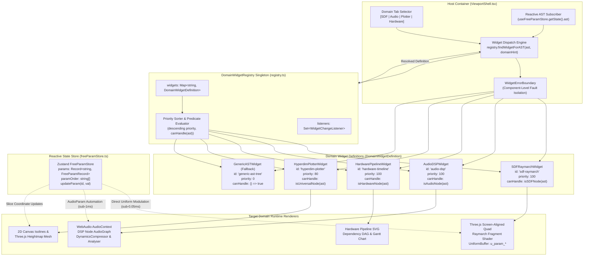

```mermaid
graph TD
    subgraph ClientEnvironment ["Client Browser Environment (Zero-Server Architecture)"]
        subgraph EditorLayer ["Monaco Editor Shell"]
            Monaco["Monaco Editor (Lean 4)<br/>Tokenization & Hover Tooltips"]
            RangeSelect["User Cursor / Range Selection<br/>(Sub-expression)"]
            Monaco --> RangeSelect
        end

        subgraph CoreEngine ["Client-Side SymForge Core Engine"]
            ASTParser["Lean 4 AST Parser<br/>(Lexer + Recursive Descent)"]
            RangeMapper["Range-to-AST Mapper<br/>(findEnclosingASTNode)"]
            HolePuncturer["AST Hole Puncturer<br/>(punctureASTHole)"]
            ZustandStore["FreeParam Reactive Store<br/>(useFreeParamStore)"]
        end

        subgraph Dispatcher ["Domain Widget Dispatcher"]
            Registry["DomainWidgetRegistry<br/>(Priority-Ordered Dispatch)"]
            ErrorBoundary["WidgetErrorBoundary<br/>(Fault Isolation)"]
        end

        subgraph Viewports ["Domain Interactive Viewports"]
            SDF["3D SDF Raymarcher<br/>(Three.js + Phong GLSL)"]
            Audio["WebAudio DSP Engine<br/>(Oscilloscope + FFT Waterfall)"]
            Plotter["Hyperdim Function Plotter<br/>(2D Contours + 3D Heightmap)"]
            HW["Hardware Register Timeline<br/>(DAG Hazards + Gantt Chart)"]
        end

        subgraph SynthesisLayer ["In-Context Synthesis Worker"]
            WorkerClient["VariationWorkerClient<br/>(Timeout Guardrail: 3000ms)"]
            WebWorker["variation.worker.ts<br/>(Off-Thread Thread Pool)"]
            PCFG["PCFG/PHOG Sampler<br/>(L1..L5 Stratification)"]
            Deduplicator["Semantic Deduplicator<br/>(Structural Identity Hash)"]
            Gallery["Variation Gallery Drawer<br/>(Thumbnail Cards & Previews)"]
        end
    end

    Monaco -->|Source Code Changes| ASTParser
    ASTParser -->|AST & FreeParams| ZustandStore
    ASTParser -->|AST Node Tree| Registry
    Registry --> ErrorBoundary
    ErrorBoundary --> SDF
    ErrorBoundary --> Audio
    ErrorBoundary --> Plotter
    ErrorBoundary --> HW
    ZustandStore -.->|Zero-Lag Uniform Modulation| SDF
    ZustandStore -.->|WebAudio Param Automation| Audio

    RangeSelect -->|Selected Range| RangeMapper
    ASTParser --> RangeMapper
    RangeMapper -->|Scoped Match Badge| Monaco
    RangeMapper -->|Scoped Target Match| HolePuncturer
    HolePuncturer -->|PunctureResult| WorkerClient
    WorkerClient --> WebWorker
    WebWorker --> PCFG
    PCFG --> Deduplicator
    Deduplicator --> Gallery
    Gallery -->|1-Click Code Injection| Monaco
```

```mermaid
graph TD
    subgraph EditorStage ["1. Selection & Range Mapping (Main Thread)"]
        Monaco["Monaco Code Editor<br/>User highlights Lean 4 code snippet"]
        SelCalc["computeSelectionRange()<br/>Maps line/column to absolute character offsets"]
        ASTMap["findEnclosingASTNode()<br/>Locates minimal enclosing AST node"]
        ScopeBadge["Scope Badge Display<br/>🎯 Scope: NodeKind (relation) [Line:Col]"]

        Monaco --> SelCalc
        SelCalc --> ASTMap
        ASTMap --> ScopeBadge
    end

    subgraph PunctureStage ["2. Type Resolution & Hole Puncturing"]
        TargetMatch["Scoped Node Match<br/>(targetNode, nodeId, span, relation)"]
        HoleFunc["punctureASTHole()<br/>Replaces targetNode with HoleNode"]
        PuncResult["PunctureResult Record<br/>- puncturedAST<br/>- targetSpan<br/>- structuralContext (parentOp, relation)<br/>- expectedType (SDFNode/AudioNode/etc.)"]

        ASTMap --> TargetMatch
        TargetMatch --> HoleFunc
        HoleFunc --> PuncResult
    end

    subgraph WorkerStage ["3. Background Web Worker Synthesis (variation.worker.ts)"]
        WorkerClient["VariationWorkerClient<br/>Dispatches request with 3000ms timeout guardrail"]
        WorkerThread["Web Worker Thread Pool<br/>Zero UI-blocking computation"]
        Sampler["PCFG / PHOG Sampler<br/>Contextual weight re-weighting matrix<br/>Curriculum stratification L1..L5"]
        PrettyPrinter["Lean 4 Code Printer<br/>Synthesizes valid formatted Lean syntax"]
        Deduper["Semantic Deduplicator<br/>AST canonicalization & hash deduplication"]

        PuncResult --> WorkerClient
        WorkerClient -->|postMessage| WorkerThread
        WorkerThread --> Sampler
        Sampler --> PrettyPrinter
        PrettyPrinter --> Deduper
    end

    subgraph GalleryStage ["4. Interactive Gallery & Auditioning (UI Shell)"]
        CandidateList["Variation Candidates List<br/>Stratified across L1..L5"]
        FilterBar["Curriculum Level Filter<br/>[ALL | L1 | L2 | L3 | L4 | L5]"]
        Card["Variation Card Preview<br/>- 3D Wireframe Canvas (SDF)<br/>- Synthesizer Tone Audition (Audio)<br/>- Pipeline Stage Preview (Hardware)"]

        Deduper -->|postMessage Response| CandidateList
        CandidateList --> FilterBar
        FilterBar --> Card
    end

    subgraph InjectionStage ["5. Atomic Code Injection & Undo Restoration"]
        InjectClick["User Clicks 'Inject Variation'"]
        MonacoEdit["model.pushEditOperations()<br/>Atomic splice at targetSpan"]
        UndoStack["Monaco Undo Stack Preserved<br/>Ctrl+Z / Cmd+Z restores original expression"]

        Card --> InjectClick
        InjectClick --> MonacoEdit
        MonacoEdit --> UndoStack
    end
```

# SymForge Lean 4 Web IDE: Architecture & Developer User Guide

---

## Table of Contents

1. [Executive System Overview](#1-executive-system-overview)
   - [Unified Vision & Paradigm](#11-unified-vision-paradigm)
   - [Zero-Server Client-Side Architecture](#12-zero-server-client-side-architecture)
   - [Client-Side AST Engine & Bidirectional Transpiler](#13-client-side-ast-engine-bidirectional-transpiler)
   - [Domain-Agnostic Widget Dispatch Pipeline](#14-domain-agnostic-widget-dispatch-pipeline)
   - [High-Level Interaction Flow Diagram](#15-high-level-interaction-flow-diagram)
2. [User Guide: Authoring & Interacting with Neurosymbolic Programs](#2-user-guide-authoring-interacting-with-neurosymbolic-programs)
   - [Writing Lean 4 Syntax](#21-writing-lean-4-syntax)
   - [Interacting with Domain Viewports](#22-interacting-with-domain-viewports)
     - [3D WebGL Signed Distance Field (SDF) Raymarcher](#221-3d-webgl-signed-distance-field-sdf-raymarcher)
     - [WebAudio DSP Synthesizer & 2048-pt FFT Spectrogram](#222-webaudio-dsp-synthesizer-2048-pt-fft-spectrogram)
     - [Hyperdimensional Function Plotter & Orthogonal Slicer](#223-hyperdimensional-function-plotter-orthogonal-slicer)
     - [Hardware Pipeline Visualizer & Register Timeline](#224-hardware-pipeline-visualizer-register-timeline)
   - [Using the In-Context Scoped Variation Generator](#23-using-the-in-context-scoped-variation-generator)
   - [Scoped Variation Pipeline Diagram](#24-scoped-variation-pipeline-diagram)
3. [Extensible Domain Widget Architecture](#3-extensible-domain-widget-architecture)
   - [Core Registration Contract](#31-core-registration-contract)
   - [Type-Predicate Guard Resolution & Priority Dispatch](#32-type-predicate-guard-resolution-priority-dispatch)
   - [Error Boundary Isolation](#33-error-boundary-isolation)
   - [Reactive FreeParam State Store Integration](#34-reactive-freeparam-state-store-integration)
   - [Widget Architecture Diagram](#35-widget-architecture-diagram)
4. [Developer & Contributor Guide](#4-developer-contributor-guide)
   - [Repository & Package Architecture](#41-repository-package-architecture)
   - [Tutorial: Registering a Custom Domain Widget](#42-tutorial-registering-a-custom-domain-widget)
   - [Tutorial: Extending Grammar Production Rules in PCFG Sampler](#43-tutorial-extending-grammar-production-rules-in-pcfg-sampler)
   - [Local Development, Testing & Verification Commands](#44-local-development-testing-verification-commands)
   - [Automated GitHub Pages CI/CD Deployment Pipeline](#45-automated-github-pages-cicd-deployment-pipeline)
   - [Progressive Web App (PWA) Offline Operation](#46-progressive-web-app-pwa-offline-operation)
5. [Architectural Invariants & Symmetrical Cross-Validation](#5-architectural-invariants-symmetrical-cross-validation)

---

## 1. Executive System Overview

### 1.1 Unified Vision & Paradigm

The **SymForge Lean 4 Web IDE** is a client-side exploratory workbench designed for the neurosymbolic synthesis, formal verification, visual exploration, and continuous parametric modulation of programmatic artifacts expressed in Lean 4 Intermediate Representation (IR).

Traditional neurosymbolic program synthesis systems suffer from three primary bottlenecks:
1. **Server Roundtrip Latency:** Synthesizers executing on remote clusters disconnect users from continuous tactile feedback loops, making sub-millisecond parameter scrubbing impossible.
2. **Domain Isolation:** Geometric computer-aided design (CAD), digital signal processing (DSP) sound synthesis, multidimensional mathematical analysis, and microarchitectural hardware pipelines are segregated into disparate siloed tools.
3. **Rigid Black-Box Infilling:** Large language models frequently regenerate entire files or broad blocks uncontrollably, losing user-authored parameter constraints, invariant annotations, and structural intent.

SymForge dissolves these boundaries. It introduces an interactive, unified web workspace where Lean 4 code serves as a single universal representation for multiple modalities. The system continuously maps typed syntax trees to domain-specific GPU shaders, WebAudio signal graphs, multidimensional coordinate slicers, and hardware register dependency DAGs—all running deterministically inside standard web browsers.

### 1.2 Zero-Server Client-Side Architecture

The application is architected under a strict **Zero-Server Mandate**:
- **Zero Backend Dependencies:** No remote Node.js, Python, or Docker daemon is required at runtime. Code editing, AST parsing, shader generation, sound synthesis, probabilistic grammar sampling, and semantic deduplication execute entirely within the client's browser runtime.
- **Offline Capability:** Leveraging standard Progressive Web Application (PWA) constructs (Service Workers, Cache Storage API, and Web App Manifest), the IDE functions in completely disconnected environments (e.g., offline laptops, secure network air-gaps).
- **Privacy & Security:** Intellectual property, proprietary Lean definitions, and exploratory parameters never leave the client device.

### 1.3 Client-Side AST Engine & Bidirectional Transpiler

At the heart of the Web IDE sits a high-speed, client-side TypeScript Abstract Syntax Tree (AST) engine:
- **Lexer & Recursive Descent Parser:** Tokenizes Lean 4 source text in $< 2\text{ ms}$, preserving exact line, column, and byte-span offsets for every expression, constructor, and argument.
- **Parametric Binding:** Automatically discovers embedded `FreeParam.mk` declarations and registers them into a reactive Zustand state store (`useFreeParamStore`).
- **Bidirectional Symmetrization:** Every AST node can be serialized to JSON, pretty-printed back to canonical Lean 4 syntax via `formatLeanCode`, or transformed into domain-specific execution representations (GLSL fragment shaders, WebAudio graphs, hardware DAGs).
- **Sub-Expression Selection Mapping:** Maps user-highlighted editor character ranges to the minimal enclosing AST node in $O(N)$ tree-walk time with $O(1)$ overlap ratio scoring.

### 1.4 Domain-Agnostic Widget Dispatch Pipeline

Rather than hardcoding viewports to specific domains, the SymForge Web IDE incorporates an open-ended **Domain Widget Registry** (`DomainWidgetRegistry`):
- **Predicate-Based Dispatch:** Visualizer widgets register domain identifiers, priority ratings, and type-predicate guards (`canHandle: (ast: ASTNode) => boolean`).
- **Dynamic Resolution:** When Lean source code changes, the viewport dynamically dispatches the highest-priority widget capable of rendering the root AST node (e.g., `isSDFNode` $\to$ 3D Raymarcher, `isAudioNode` $\to$ WebAudio DSP, `isHardwareNode` $\to$ Pipeline Visualizer, `isUniversalNode` $\to$ Hyperdim Plotter).
- **Fallback Resilience:** Any unrecognized or custom node tree gracefully falls back to the generic interactive `GenericASTWidget`, guaranteeing that the user interface never crashes on novel expressions.

---

### 1.5 High-Level Interaction Flow Diagram

```text
+---------------------------------------------------------------------------------------------------+
|                                 SYMFORGE WEB IDE INTERACTION FLOW                                 |
|                                                                                                   |
|  [ Monaco Editor (Lean 4) ]                                                                       |
|         |                                                                                         |
|         | 1. Code Change (onChange)                                                               |
|         v                                                                                         |
|  [ Client-Side AST Parser ] <---> [ FreeParamStore (Zustand) ]                                    |
|         |                                    |                                                    |
|         | 2. AST Nodes & FreeParams          | 3. Sub-ms Parameter Scrubbing                      |
|         v                                    v                                                    |
|  [ DomainWidgetRegistry ]             [ Active Domain Viewport ]                                  |
|         |                                  |-- 3D WebGL SDF Raymarcher                            |
|         +--> Dispatch (canHandle) -------->|-- WebAudio DSP Synthesizer                           |
|                                            |-- Hyperdimensional Plotter                           |
|                                            +-- Hardware Register Timeline                         |
|                                                                                                   |
|  [ User Range Selection ]                                                                         |
|         |                                                                                         |
|         | 4. Highlight Expression                                                                 |
|         v                                                                                         |
|  [ Selection Mapper ] ---> [ Scope Badge ]                                                        |
|         |                                                                                         |
|         | 5. Trigger In-Context Variation                                                         |
|         v                                                                                         |
|  [ AST Hole Puncturing ] ---> [ Background Web Worker ]                                           |
|                                      |                                                            |
|                                      | 6. PCFG Sampling (L1..L5) & Deduplication                  |
|                                      v                                                            |
|                               [ Variation Gallery Drawer ]                                        |
|                                      |                                                            |
|                                      | 7. 1-Click Code Injection (Ctrl+Z Undo Invariance)         |
|                                      v                                                            |
|                               [ Monaco Editor (Updated) ]                                         |
+---------------------------------------------------------------------------------------------------+
```



---

## 2. User Guide: Authoring & Interacting with Neurosymbolic Programs

### 2.1 Writing Lean 4 Syntax

All programs in the SymForge Web IDE are written in standard Lean 4 syntax adhering to the `SymforgeIr.Types` specification.

#### Declarations & Header
A program consists of an optional `import SymforgeIr.Types` line followed by one or more typed definitions:
```lean
import SymforgeIr.Types

def myModel : SDFNode :=
  ...
```

#### Constructors by Domain

1. **Signed Distance Fields (`SDFNode`)**:
   - Primitive Solids:
     - `SDFNode.sphere (FreeParam.mk "radius" 1.0 0.1 5.0)`
     - `SDFNode.box (FreeParam.mk "half_x" 1.0 0.1 5.0) (FreeParam.mk "half_y" 1.0 0.1 5.0) (FreeParam.mk "half_z" 1.0 0.1 5.0)`
     - `SDFNode.cylinder (FreeParam.mk "radius" 0.5 0.1 3.0) (FreeParam.mk "half_height" 1.2 0.1 4.0)`
     - `SDFNode.torus (FreeParam.mk "major_r" 1.2 0.2 4.0) (FreeParam.mk "minor_r" 0.3 0.05 1.5)`
     - `SDFNode.plane (FreeParam.mk "nx" 0.0 -1.0 1.0) (FreeParam.mk "ny" 1.0 -1.0 1.0) (FreeParam.mk "nz" 0.0 -1.0 1.0) (FreeParam.mk "offset" 0.0 -5.0 5.0)`
     - `SDFNode.gyroid (FreeParam.mk "scale" 3.14 0.5 10.0) (FreeParam.mk "thickness" 0.08 0.01 0.5)`
   - Affine Transformations:
     - `SDFNode.translate (FreeParam.mk "dx" 0.0 -5.0 5.0) (FreeParam.mk "dy" 0.0 -5.0 5.0) (FreeParam.mk "dz" 0.0 -5.0 5.0) (childNode)`
     - `SDFNode.rotate (FreeParam.mk "pitch" 0.0 -3.14 3.14) (FreeParam.mk "yaw" 0.0 -3.14 3.14) (FreeParam.mk "roll" 0.0 -3.14 3.14) (childNode)`
     - `SDFNode.scale (FreeParam.mk "factor" 1.0 0.1 5.0) (childNode)`
   - Boolean Constructive Solid Geometry (CSG):
     - `SDFNode.union (childA) (childB)`
     - `SDFNode.smooth_union (FreeParam.mk "k" 0.2 0.01 1.0) (childA) (childB)`
     - `SDFNode.intersection (childA) (childB)`
     - `SDFNode.difference (childA) (childB)`

2. **WebAudio DSP Graphs (`AudioNode`)**:
   - Oscillators & Generators:
     - `AudioNode.sine (FreeParam.mk "freq" 440.0 20.0 5000.0) (FreeParam.mk "phase" 0.0 0.0 6.28)`
     - `AudioNode.saw (FreeParam.mk "freq" 220.0 20.0 5000.0)`
     - `AudioNode.square (FreeParam.mk "freq" 110.0 20.0 5000.0) (FreeParam.mk "duty" 0.5 0.01 0.99)`
     - `AudioNode.noise`
     - `AudioNode.fm (FreeParam.mk "carrier" 440.0 20.0 5000.0) (FreeParam.mk "modulator" 110.0 1.0 1000.0) (FreeParam.mk "index" 2.5 0.0 10.0)`
   - Modifiers & Envelopes:
     - `AudioNode.lowpass (FreeParam.mk "cutoff" 880.0 20.0 20000.0) (FreeParam.mk "resonance" 1.414 0.1 10.0) (inputNode)`
     - `AudioNode.gain (FreeParam.mk "gain" 0.8 0.0 2.0) (inputNode)`
     - `AudioNode.adsr (FreeParam.mk "attack" 0.05 0.001 2.0) (FreeParam.mk "decay" 0.1 0.001 2.0) (FreeParam.mk "sustain" 0.7 0.0 1.0) (FreeParam.mk "release" 0.3 0.001 5.0) (inputNode)`
     - `AudioNode.mix (childA) (childB)`

3. **Hardware Microarchitecture Pipelines (`HardwareNode`)**:
   - Operands:
     - `HardwareNode.reg "r0"`
     - `HardwareNode.imm 42`
   - Arithmetic, Logic & Shift Operations:
     - `HardwareNode.add (lhs) (rhs)`
     - `HardwareNode.sub (lhs) (rhs)`
     - `HardwareNode.mul (lhs) (rhs)`
     - `HardwareNode.shl (child) (FreeParam.mk "bits" 2.0 0.0 31.0)`
     - `HardwareNode.shr (child) (FreeParam.mk "bits" 1.0 0.0 31.0)`
     - `HardwareNode.seq (instruction1) (instruction2)`

4. **Universal Coordinate Projections (`UniversalNode`)**:
   - `UniversalNode.universal_sdf (SDFNode)`
   - `UniversalNode.universal_audio (AudioNode)`
   - `UniversalNode.universal_hardware (HardwareNode)`

#### Parameter Formatting: FreeParam
Continuous variables are exposed through the `FreeParam.mk` constructor:
```lean
FreeParam.mk "<identifier>" <default_value> <min_bound> <max_bound>
```
Example:
```lean
(FreeParam.mk "cutoff" 1200.0 20.0 20000.0)
```
- `<identifier>`: Unique string identifying the uniform or control (letters, digits, underscores).
- `<default_value>`: Initial floating-point value.
- `<min_bound>`: Minimum slider range.
- `<max_bound>`: Maximum slider range.

The IDE continuously extracts every `FreeParam` into the **Parameter Inspector Drawer**, allowing instant real-time scrubbing without triggering AST re-parsing.

---

### 2.2 Interacting with Domain Viewports

The central viewport dynamically loads the visualizer matching the root AST declaration type. Users can also manually force viewports via the top domain tabs: `SDF`, `Audio`, `Plotter`, and `Hardware`.

```text
+---------------------------------------------------------------------------------------------------+
|  [ Domain Tabs:  [SDF]   [Audio]   [Plotter]   [Hardware] ]                   [Full Screen]       |
|---------------------------------------------------------------------------------------------------|
|                                                                                                   |
|                                       ACTIVE DOMAIN VIEWPORT                                      |
|                                                                                                   |
|  (3D Raymarcher Canvas / Audio Waterfall / Multidim Plotter Mesh / Hardware Pipeline Graph)       |
|                                                                                                   |
|---------------------------------------------------------------------------------------------------|
|  [ Controls / Sliders / Slicing Toolbar ]                                                         |
+---------------------------------------------------------------------------------------------------+
```

#### 2.2.1 3D WebGL Signed Distance Field (SDF) Raymarcher
The SDF Raymarcher renders mathematical distance fields onto a full-screen GPU quad via WebGL fragment shaders compiled on-the-fly.
- **Virtual OrbitControls:**
  - **Rotate:** Click and drag with the Left Mouse Button (LMB) to rotate the camera around the origin.
  - **Pan:** Click and drag with the Right Mouse Button (RMB) to translate the camera focus point.
  - **Zoom:** Scroll the mouse wheel to adjust camera distance.
  - **Reset Camera:** Click the `Reset Cam` button in the toolbar to restore the default azimuth ($45^\circ$) and elevation ($30^\circ$).
- **Cross-Sectional Slicing Planes:**
  - Click `Slice: None`, `Slice: XY`, `Slice: YZ`, or `Slice: ZX` to inspect internal geometries, voids, and gyroid lattices.
  - When slicing is enabled, an interactive **Offset Slider** appears, allowing continuous inspection across the $[-3.0, +3.0]$ coordinate range.
- **Real-Time Uniform Modulation:**
  - Moving any slider in the Parameter Inspector updates GPU uniforms in $< 0.05\text{ ms}$ via `UniformBindingManager.bindMaterial`.
  - Shader compilation is bypassed during parameter scrub; only the uniform buffer values change, guaranteeing 60+ FPS interaction.

#### 2.2.2 WebAudio DSP Synthesizer & 2048-pt FFT Spectrogram
The Audio DSP Viewport compiles Lean 4 `AudioNode` trees into live WebAudio audio-rate execution graphs.
- **Dual-Mode Visualizer Display:**
  - **Split View:** Displays the real-time time-domain Oscilloscope on the top half and the 2048-point logarithmic Fast Fourier Transform (FFT) spectrogram waterfall on the bottom half.
  - **Oscilloscope Mode:** Dedicated full-screen high-frequency time-domain waveform analysis.
  - **FFT Spectrum Mode:** Dedicated logarithmic frequency analyzer ($20\text{ Hz} \to 20\text{ kHz}$) highlighting spectral peaks, harmonics, and filter cutoffs.
- **Acoustic Safety Limiter:**
  - A two-stage safety protection circuit is placed before browser destination:
    - `DynamicsCompressorNode`: Threshold $-12\text{ dB}$, Knee $30\text{ dB}$, Ratio $12:1$, Attack $0.003\text{ s}$, Release $0.25\text{ s}$.
    - Hard Master Gain limiter ($0.7$) preventing ear fatigue and speaker clipping.
- **Audition Triggers:**
  - **Play / Pause:** Starts or suspends the audio context graph.
  - **Trigger Gate (Audition):** Press and hold to open the ADSR envelope gate; releasing smoothly closes the envelope according to the configured release curve.

#### 2.2.3 Hyperdimensional Function Plotter & Orthogonal Slicer
The Hyperdimensional Plotter visualizes scalar fields and mathematical surfaces $f: \mathbb{R}^n \to \mathbb{R}$.
- **2D Contour Slice Heatmaps:**
  - Evaluates zero-allocation 2D slices over `Float32Array` buffers.
  - Renders colored heatmaps using smooth scientific colormaps (`Viridis`, `Magma`, `Coolwarm`, `Turbo`).
  - Automatically extracts and overlays 8 concentric isoline contours via vectorized Marching Squares.
- **3D Heightmap Surface Projection:**
  - Projects the 2D slice onto a dynamic Three.js 3D plane mesh ($64 \times 64$ to $128 \times 128$ resolution).
  - Normal vectors are recomputed dynamically on the GPU to give rich specular shading over topological peaks and valleys.
- **Orthogonal Dimension Slicing:**
  - For functions where $n > 2$ (e.g., 5D Rastrigin, Ackley, or Sphere benchmarks), the toolbar provides coordinate selectors for primary axes ($X_0, X_1$).
  - Expanding the **Orthogonal Slices Drawer** reveals continuous scrub sliders for remaining pinned axes ($X_2, X_3, X_4 \dots$). Moving these sliders sweeps the 2D/3D slice through hyperspace in real-time.
  - Click `Reset Slices` to return all orthogonal coordinates to origin ($0.0$).

#### 2.2.4 Hardware Pipeline Visualizer & Register Timeline
The Hardware Pipeline Viewport models instruction execution, data dependencies, and clock cycles for procedural hardware pipelines.
- **Hazard Detection & Dependency DAG:**
  - Instructions are parsed into Directed Acyclic Graph (DAG) nodes (`FETCH`, `DECODE`, `EXEC`, `WRITEBACK`).
  - Data dependencies are analyzed and highlighted with color-coded directional arrows:
    - **RAW (Read-After-Write):** Red / Coral directed arrows with `#arrow-raw` markers.
    - **WAR (Write-After-Read):** Amber / Gold directed arrows with `#arrow-war` markers.
    - **WAW (Write-After-Write):** Purple / Indigo directed arrows with `#arrow-waw` markers.
- **Multi-Stage Clock Cycle Gantt Chart:**
  - Visualizes instruction progression through standard 5-stage RISC pipeline stages (`IF`, `ID`, `EX`, `MEM`, `WB`).
  - Stalls and bubble insertion cycles are marked clearly with striped hazard patterns.
  - Displays register live range intervals ($R_0 \dots R_7$) from first write to final read.
- **Interactive Cycle Stepper & KPI Metrics:**
  - **Play / Pause & Step Forward / Step Backward:** Step cycle-by-cycle or animate execution at variable speeds.
  - **Superscalar Issue Width:** Toggle between 1-Way and 2-Way superscalar issue simulation to observe stall reduction.
  - **Live KPI Readout:** Total Execution Cycles, Total Instructions, Cycles Per Instruction (CPI), and Pipeline Stall Count.

---

### 2.3 Using the In-Context Scoped Variation Generator

The Scoped Variation Generator allows users to select any sub-expression in their Lean 4 code and synthesize mathematically valid, context-aware alternative subtrees without altering surrounding code.

```text
+---------------------------------------------------------------------------------------------------+
|  STEP 1: SELECT SUB-EXPRESSION IN MONACO EDITOR                                                   |
|                                                                                                   |
|  def myGyroidSDF : SDFNode :=                                                                     |
|    SDFNode.intersection                                                                           |
|      |-------------------------------------------------------|                                    |
|      | (SDFNode.sphere (FreeParam.mk "radius" 1.25 0.5 3.0)) | <--- Highlight this expression     |
|      |-------------------------------------------------------|                                    |
|      (SDFNode.gyroid (FreeParam.mk "scale" 3.14 1.0 10.0) ...)                                    |
|                                                                                                   |
|  EDITOR BADGE APPEARS:                                                                            |
|  🎯 Scope: SphereNode (child: a) [L4:5 - L4:58]  [⚡ Generate Variations]                        |
+---------------------------------------------------------------------------------------------------+
                                       |
                                       v
+---------------------------------------------------------------------------------------------------+
|  STEP 2: VARIATION GALLERY SLIDING DRAWER OPENS                                                   |
|                                                                                                   |
|  Curriculum Filter: [ ALL (8) ]  [ L1: Atomic (2) ]  [ L2: Unary (2) ]  [ L3: CSG (2) ] ...       |
|                                                                                                   |
|  +-----------------------------+  +-----------------------------+                                 |
|  | [L1] Canonical Cylinder     |  | [L3] Smooth Blend Torus     |                                 |
|  | [3D Wireframe Preview Canvas|  | [3D Wireframe Preview Canvas|                                 |
|  |  (Click-drag to rotate)]    |  |  (Click-drag to rotate)]    |                                 |
|  |                             |  |                             |                                 |
|  | SDFNode.cylinder            |  | SDFNode.smooth_union        |                                 |
|  |   (FreeParam.mk "rad" 0.8)  |  |   (FreeParam.mk "k" 0.3)    |                                 |
|  |   ...                       |  |   (SDFNode.torus ...) ...   |                                 |
|  |                             |  |                             |                                 |
|  | [ Inject Variation ]        |  | [ Inject Variation ]        |                                 |
|  +-----------------------------+  +-----------------------------+                                 |
+---------------------------------------------------------------------------------------------------+
                                       |
                                       v
+---------------------------------------------------------------------------------------------------+
|  STEP 3: 1-CLICK CODE INJECTION & ATOMIC UNDO INVARIANCE                                          |
|                                                                                                   |
|  Clicking [Inject Variation] atomically splices the selected candidate into Monaco at the exact   |
|  character span. Surrounding indentation and parameter formatting are preserved.                  |
|                                                                                                   |
|  UNDO INVARIANCE: Pressing Ctrl+Z (or Cmd+Z) immediately restores the original expression.        |
+---------------------------------------------------------------------------------------------------+
```

#### Detailed Workflow Steps

1. **Highlighting the Expression:**
   - In the Monaco Editor, use your mouse or keyboard (`Shift + Arrow`) to select any sub-expression (e.g., `(SDFNode.sphere ...)`).
   - The editor header immediately updates with a yellow **Scope Badge**:
     `🎯 Scope: SphereNode (child: a) [L4:5 - L4:58]`
   - If no text is selected, clicking **✨ Scoped Variation** targets the root AST node by default.

2. **Triggering Synthesis:**
   - Click the `⚡ Generate Variations` button in the editor header or the top `✨ Scoped Variation` button.
   - The IDE punctures an AST hole at the selected node, captures its `StructuralContext` (parent operator, relation `a` or `b`, depth, sibling types, and expected domain), and dispatches a synthesis request to the background Web Worker (`variation.worker.ts`).

3. **Filtering by Curriculum Complexity ($L_1 \dots L_5$):**
   - The **Variation Gallery Drawer** slides in from the right.
   - Candidates are categorized across 5 pedagogical complexity tiers:
     - **$L_1$ (Atomic):** Primitives and terminal tokens (e.g., `sphere`, `cylinder`, `sine`, `reg`).
     - **$L_2$ (Unary):** Affine transformations, filters, and bitshifts (e.g., `translate`, `rotate`, `lowpass`, `shl`).
     - **$L_3$ (Binary / CSG):** Boolean intersections, unions, audio mixes, and arithmetic operations.
     - **$L_4$ (Composite):** Nested 3-level expressions combining transformations with smooth operators.
     - **$L_5$ (Deep Recursive):** Multi-level hierarchies featuring procedural lattices, modulated envelopes, or multi-stage pipelines.
   - Click the filter chips (`ALL`, `L1`, `L2`, `L3`, `L4`, `L5`) to narrow candidates.

4. **Auditioning Previews:**
   - **SDF Candidates:** Each card embeds a live 3D wireframe canvas. Click and drag on any card thumbnail to inspect its 3D geometry from any angle before injecting.
   - **Audio Candidates:** Audio cards feature an inline **Audition Tone** trigger to play sound snippets directly inside the gallery.
   - **Hardware Candidates:** Hardware cards render an inline micro-pipeline flow icon (`FETCH` $\to$ `DECODE` $\to$ `EXEC`).

5. **1-Click Atomic Injection & Undo Restoration:**
   - Click the blue **Inject Variation** button on any card.
   - The selected candidate is atomically spliced into the Monaco model using `model.pushEditOperations`.
   - The gallery drawer closes smoothly.
   - **Undo Invariance Gate:** The transaction is pushed to Monaco's native undo stack. Pressing `Ctrl+Z` (or `Cmd+Z` on macOS) immediately restores the original code with zero residual artifacts.

---

### 2.4 Scoped Variation Pipeline Diagram

```text
+---------------------------------------------------------------------------------------------------+
|                              SCOPED VARIATION IN-CONTEXT PIPELINE                                 |
|                                                                                                   |
|  [ User Selection in Monaco ]                                                                     |
|         |                                                                                         |
|         | Line/Col Range                                                                          |
|         v                                                                                         |
|  [ computeSelectionRange() ] ---> Character Offsets (startOffset, endOffset)                      |
|         |                                                                                         |
|         v                                                                                         |
|  [ findEnclosingASTNode() ] -----> Minimal Enclosing Target Node + Parent Relation                |
|         |                                                                                         |
|         v                                                                                         |
|  [ punctureASTHole() ] ----------> PunctureResult:                                                |
|                                    - puncturedAST (HoleNode inserted)                             |
|                                    - targetSpan (precise code slice)                              |
|                                    - structuralContext (parentOp, depth, sibling)                 |
|                                    - expectedType ('SDFNode' | 'AudioNode' | etc.)                |
|                                                                                                   |
|                                          |                                                        |
|  [ Main Thread: WorkerClient ]           | postMessage()                                          |
|  ----------------------------------------|------------------------------------------------------  |
|  [ Worker Thread: variation.worker.ts ]  v                                                        |
|                                                                                                   |
|  [ Contextual PCFG/PHOG Sampler ] <------- Applies Re-weighting Multiplier Matrix                 |
|         |                                                                                         |
|         | Generates raw candidate ASTs across L1..L5                                              |
|         v                                                                                         |
|  [ Lean 4 Code Printer ] ----------------> Pretty-prints code expressions                         |
|         |                                                                                         |
|         v                                                                                         |
|  [ Semantic Deduplicator ] --------------> Filters duplicates & identity transforms               |
|                                                                                                   |
|                                          |                                                        |
|  [ Main Thread: Variation Gallery ]      | postMessage(candidates)                                |
|  ----------------------------------------|------------------------------------------------------  |
|                                          v                                                        |
|  [ User Clicks 'Inject Variation' ] -----> editorRef.injectCodeAtSpan()                           |
|                                            (Atomic Monaco pushEditOperations, Ctrl+Z preserved)   |
+---------------------------------------------------------------------------------------------------+
```



---

## 3. Extensible Domain Widget Architecture

### 3.1 Core Registration Contract

Custom domain visualizers integrate through the standard `DomainWidgetDefinition` interface defined in `packages/web/src/components/widgets/types.ts`:

```typescript
export interface DomainWidgetDefinition<T extends ASTNode = ASTNode> {
  /** Unique machine identifier for this widget (e.g. 'sdf-raymarch') */
  readonly id: string;

  /** Human-readable display label shown in widget headers and selector menus */
  readonly name: string;

  /** Primary domain classification */
  readonly domain: DomainType | string;

  /** Descriptive synopsis of rendering capabilities and interactive features */
  readonly description: string;

  /**
   * Type predicate guard determining whether this widget can render the given AST node.
   * Return true if the node conforms to this widget's expected domain model.
   */
  readonly canHandle: (ast: ASTNode) => boolean;

  /** React component rendering the interactive viewport */
  readonly component: React.ComponentType<DomainWidgetProps<T>>;

  /**
   * Priority score used when multiple widgets return true for canHandle.
   * Higher priority widgets are selected first.
   */
  readonly priority: number;
}
```

The props delivered to every domain widget component conform to `DomainWidgetProps<T>`:
```typescript
export interface DomainWidgetProps<T extends ASTNode = ASTNode> {
  readonly ast: T | null;
  readonly declarationName?: string;
  readonly domain?: string;
  readonly isPaused?: boolean;
  readonly dataTestId?: string;
}
```

---

### 3.2 Type-Predicate Guard Resolution & Priority Dispatch

The `DomainWidgetRegistry` singleton resolves the active widget via `findWidgetForAST(ast, domainHint)`:
1. Filters all registered definitions by evaluating their `canHandle(ast)` guard function.
2. If `domainHint` is provided (e.g., user selected the `Audio` tab), definitions matching `w.domain === domainHint` are given preference.
3. Sorts qualifying widgets in descending order of their numerical `priority` property.
4. Returns the top-ranked definition. If no domain-specific widget qualifies, it returns `generic-ast-tree` (`GenericASTWidget`, priority $0$).

---

### 3.3 Error Boundary Isolation

Every widget component rendered inside `ViewportShell` is wrapped in a dedicated `WidgetErrorBoundary`:
- **Crash Containment:** A crash or WebGL context loss inside a custom visualizer will **never** bring down the Monaco editor, parameter store, or main application shell.
- **Diagnostic Fallback Card:** Displays the runtime error name, message, stack snippet, and active declaration name, alongside a **Retry Render** button.
- **Graceful Software Degradation:** If WebGL or WebAudio is unavailable in headless test runners or legacy devices, widgets gracefully render fallback cards rather than throwing uncaught exceptions.

---

### 3.4 Reactive FreeParam State Store Integration

The `useFreeParamStore` Zustand store bridges the Lean 4 AST with continuous slider manipulation:
- **Instant Parameter Reads:** Viewports subscribe to specific parameter IDs via fine-grained Zustand selectors (e.g., `useFreeParamStore(s => s.params[id]?.value)`).
- **Zero-Allocation GPU Uniform Injection:** For shaders, `UniformBindingManager` listens directly to `useFreeParamStore.subscribe()`, writing modified values straight into Three.js uniform floats without triggering React render passes.
- **Bidirectional Invariant:** When Lean code is edited, `setAST` re-synchronizes discovered `FreeParam` records while preserving current user slider positions if the parameter identifier matches.

---

### 3.5 Widget Architecture Diagram

```text
+---------------------------------------------------------------------------------------------------+
|                               EXTENSIBLE WIDGET ARCHITECTURE                                      |
|                                                                                                   |
|  [ ViewportShell.tsx ]                                                                            |
|    |                                                                                              |
|    +---> Reads Active AST from FreeParamStore                                                     |
|    +---> Invokes DomainWidgetRegistry.findWidgetForAST(ast, activeTab)                            |
|                                                                                                   |
|  [ DomainWidgetRegistry (registry.ts) ]                                                           |
|    |                                                                                              |
|    |-- 1. Check canHandle(ast) predicates:                                                        |
|    |      - isSDFNode(ast)          --> 'sdf-raymarch'       (priority: 100)                      |
|    |      - isAudioNode(ast)        --> 'audio-dsp'          (priority: 100)                      |
|    |      - isHardwareNode(ast)     --> 'hardware-timeline'  (priority: 100)                      |
|    |      - isUniversalNode(ast)    --> 'hyperdim-plotter'   (priority: 80)                       |
|    |      - () => true              --> 'generic-ast-tree'   (priority: 0, fallback)              |
|    |                                                                                              |
|    +--> Returns Top Priority Matching Widget Definition                                           |
|                                                                                                   |
|  [ WidgetErrorBoundary (Fault Isolation) ]                                                        |
|    |                                                                                              |
|    +---> Mounts Resolved Component with DomainWidgetProps                                         |
|    +---> Catches WebGL/WebAudio/DOM errors without crashing Monaco Editor                          |
|                                                                                                   |
|  [ FreeParamStore (Zustand) ]                                                                     |
|    |                                                                                              |
|    +---> Direct GPU Uniform Binding (sub-0.05ms without React re-renders)                         |
|    +---> WebAudio Param Automation (sub-1ms)                                                      |
+---------------------------------------------------------------------------------------------------+
```



---

## 4. Developer & Contributor Guide

### 4.1 Repository & Package Architecture

The Web IDE package resides inside `packages/web/` within the SymForge repository.

```text
packages/web/
├── public/
│   ├── icons/               # Web Application icons (192x192, 512x512)
│   ├── favicon.svg          # SVG vector favicon
│   ├── manifest.json        # W3C PWA Progressive Web App manifest
│   └── sw.js                # Production Service Worker (Cache-First + Stale-While-Revalidate)
├── e2e/
│   └── web_ide.spec.ts      # Playwright end-to-end browser smoke test suite
├── src/
│   ├── components/
│   │   ├── editor/          # Monaco Editor wrapper, Lean 4 Monarch tokenizer & hover providers
│   │   ├── gallery/         # Scoped Variation Gallery drawer, candidate cards & thumbnails
│   │   ├── inspector/       # Reactive FreeParam slider inspector drawer
│   │   └── widgets/         # Extensible Domain Viewport widgets
│   │       ├── audio/       # WebAudio DSP compiler, oscilloscope & FFT visualizer
│   │       ├── hardware/    # Hardware pipeline parser, hazard DAG & clock Gantt chart
│   │       ├── hyperdim/    # Multidimensional function evaluator, 2D contours & 3D heightmaps
│   │       ├── sdf/         # WebGL raymarching fragment shader codegen & Three.js canvas
│   │       ├── registry.ts  # DomainWidgetRegistry singleton engine
│   │       ├── types.ts     # Widget definition contracts & interfaces
│   │       └── ViewportShell.tsx # Top-level dynamic viewport host & domain tab bar
│   ├── core/
│   │   ├── ast/             # TypeScript AST models, type guards, serialization & tree metrics
│   │   ├── generator/       # Sub-expression selection mapper & AST hole puncturing engine
│   │   ├── parser/          # Lean 4 lexer, recursive descent parser & pretty-printer
│   │   ├── pcfg/            # Contextual PCFG/PHOG sampler with curriculum stratification (L1..L5)
│   │   └── store/           # Zustand reactive FreeParam state store & uniform synchronization
│   ├── pwa/
│   │   └── registerServiceWorker.ts # Browser Service Worker lifecycle & update listener
│   ├── test/                # Global test setup (Vitest + JSDOM mocks for WebGL & WebAudio)
│   ├── workers/             # Dedicated Web Worker for off-thread synthesis & deduplication
│   │   ├── deduplicator.ts  # Semantic AST normalization & hash-based deduplication
│   │   ├── variation.worker.ts # Background Web Worker thread entrypoint
│   │   └── variationWorkerClient.ts # Main-thread Promise RPC client with 3000ms timeout guard
│   ├── App.tsx              # Root IDE application shell layout & event coordinator
│   └── main.tsx             # Application mount point & PWA registration
├── package.json             # Web package dependencies, scripts & metadata
├── playwright.config.ts     # Playwright configuration with SwiftShader software WebGL flags
├── tsconfig.json            # Strict TypeScript compiler options
└── vite.config.ts           # Vite bundler configuration (chunk splitting, PWA plugins, 404 fallback)
```

---

### 4.2 Tutorial: Registering a Custom Domain Widget

To add a new visualization domain (for example, a **Kinematic Robotic Arm Visualizer**), follow these four steps:

#### Step 1: Define Your AST Node Type
Ensure your AST node type exists in `packages/web/src/core/ast/types.ts` and add a type guard in `models.ts`:
```typescript
export interface KinematicsNode extends BaseASTNode {
  readonly kind: 'KinematicsNode';
  readonly op: 'joint' | 'link' | 'end_effector';
  readonly angle?: FreeParam;
  readonly length?: FreeParam;
  readonly children: KinematicsNode[];
}

export function isKinematicsNode(node: ASTNode | null | undefined): node is KinematicsNode {
  return node?.kind === 'KinematicsNode';
}
```

#### Step 2: Implement Your React Widget Component
Create `KinematicsWidget.tsx`:
```tsx
import React from 'react';
import type { DomainWidgetProps } from '../types';
import type { KinematicsNode } from '../../../core/ast/types';

export const KinematicsWidget: React.FC<DomainWidgetProps<KinematicsNode>> = ({
  ast,
  declarationName,
}) => {
  if (!ast) {
    return <div className="widget-empty">No kinematic definition loaded.</div>;
  }

  return (
    <div className="kinematics-viewport" data-testid="kinematics-widget">
      <h3>Kinematic Chain: {declarationName}</h3>
      {/* Render SVG or Three.js 2D/3D robotic joints */}
    </div>
  );
};
```

#### Step 3: Define the Widget Specification
```typescript
import { KinematicsWidget } from './KinematicsWidget';
import { isKinematicsNode } from '../../../core/ast/models';
import type { DomainWidgetDefinition } from '../types';

export const kinematicsWidgetDef: DomainWidgetDefinition = {
  id: 'kinematics-visualizer',
  name: 'Robotic Kinematics Chain',
  domain: 'kinematics',
  description: 'Interactive forward and inverse kinematics visualizer for multi-joint robotic arms.',
  canHandle: (ast) => isKinematicsNode(ast),
  component: KinematicsWidget,
  priority: 100,
};
```

#### Step 4: Register with `DomainWidgetRegistry`
In your application initialization (or inside `createDefaultWidgetDefinitions` in `packages/web/src/components/widgets/registry.ts`):
```typescript
import { defaultWidgetRegistry } from './registry';
import { kinematicsWidgetDef } from './KinematicsWidget';

defaultWidgetRegistry.registerWidget(kinematicsWidgetDef);
```
That's it! When a user opens or authors a `KinematicsNode` in Lean 4, `ViewportShell` automatically dispatches `KinematicsWidget`.

---

### 4.3 Tutorial: Extending Grammar Production Rules in PCFG Sampler

The in-context variation generator relies on `pcfgSampler.ts` to synthesize candidate expressions.

#### Step 1: Add Production Rules
Open `packages/web/src/core/pcfg/pcfgSampler.ts` and locate the appropriate domain grammar function (e.g., `getSDFRules`):
```typescript
function getSDFRules(): GrammarProductionRule[] {
  return [
    // Existing rules...
    { nonTerminal: 'SDF_Term', constructorName: 'sphere', probability: 0.25, childNonTerminals: [], isTerminal: true, domain: 'sdf' },

    // Add new custom primitive (e.g. Capsule):
    {
      nonTerminal: 'SDF_Term',
      constructorName: 'capsule',
      probability: 0.15,
      childNonTerminals: [],
      isTerminal: true,
      domain: 'sdf',
    },
  ];
}
```

#### Step 2: Implement Constructor Instantiation
In the node generation switch in `pcfgSampler.ts`:
```typescript
case 'capsule':
  return createCapsule(
    createFreeParam('cap_radius', 0.5, 0.1, 2.0),
    createFreeParam('cap_height', 1.0, 0.2, 4.0)
  );
```

#### Step 3: Define Contextual PHOG Re-Weighting
To bias capsule generation when the parent is a subtraction or union, update `getSDFMultipliers`:
```typescript
function getSDFMultipliers(context: StructuralContext): Record<string, number> {
  const mults: Record<string, number> = {};
  if (context.parentOp === 'difference') {
    mults.capsule = 2.5; // Bias towards cutting capsules through geometry
  }
  return mults;
}
```

---

### 4.4 Local Development, Testing & Verification Commands

All development commands run from the monorepo root or directly within `packages/web/`.

| Command | Purpose | Invariants Verified |
| :--- | :--- | :--- |
| `npm --prefix packages/web run dev` | Starts Vite local development server on `http://localhost:5173` | Hot Module Replacement (HMR) active |
| `npm --prefix packages/web run build` | Compiles TypeScript and executes Vite production bundler | 0 TypeScript errors, bundle size within chunk budgets |
| `npm --prefix packages/web run preview` | Serves the production `dist/` directory on `http://localhost:4173` | Production artifact inspection |
| `npm --prefix packages/web test -- run` | Executes all Vitest unit and component tests | 400+ unit tests passing cleanly in parallel |
| `npm --prefix packages/web run test:e2e` | Executes Playwright headless browser smoke tests | Headless WebGL canvas, Monaco editor, audio context, and variation tests pass |
| `python3 ~/.gemini/skills/code-guard-validator/scripts/validate_rules.py` | Runs Code Guard static architectural compliance checks | Async timeouts, loop caps, exception contexts, and resource severance |

---

### 4.5 Automated GitHub Pages CI/CD Deployment Pipeline

The application features an automated, zero-touch Continuous Integration & Continuous Deployment (CI/CD) workflow defined in `.github/workflows/deploy_web_ide.yml`.

#### Workflow Architecture

```text
[ Push to main (packages/web/**) ]
       |
       +---> Job 1: Build & Test (ubuntu-latest, Node.js 22 LTS)
       |        |
       |        +--> npm ci
       |        +--> npm test -- run (Vitest 400+ tests pass)
       |        +--> VITE_BASE_PATH=/symforge/ npm run build
       |        +--> Upload Pages Artifact (packages/web/dist)
       |
       +---> Job 2: Deploy to GitHub Pages (environment: github-pages)
                |
                +--> actions/deploy-pages@v4
                +--> Live on: https://<org>.github.io/symforge/
```

#### Critical Deployment Invariants
- **Base Path Resolution:** GitHub Pages deploys under the `/symforge/` repository path. Vite is configured with `base: process.env.VITE_BASE_PATH || '/'` in `vite.config.ts`, ensuring that all asset scripts, workers, and CSS chunks load correctly.
- **Single-Page Application 404 Fallback:** GitHub Pages returns a native 404 on deep routes or page reloads. A custom Vite build plugin automatically copies `dist/index.html` to `dist/404.html`, enabling seamless client-side routing.
- **Worker Chunk Inlining:** Workers (`variation.worker.ts`) and Monaco workers (`editor.worker.js`) are configured with ESM format and explicit MIME types to satisfy browser cross-origin isolation policies.

---

### 4.6 Progressive Web App (PWA) Offline Operation

SymForge includes a production-grade Progressive Web Application configuration:
- **`manifest.json`:** Declares application name, theme colors (`#0f172a`), icons (`192x192`, `512x512`), and standalone display mode.
- **Service Worker (`public/sw.js`):**
  - **App Shell:** Uses a **Stale-While-Revalidate** caching strategy for `index.html` and primary route manifests, ensuring instant startup while background-checking for updates.
  - **Static Assets:** Uses a **Cache-First** caching strategy for immutable hashed chunks (`/assets/*`, Three.js vendor scripts, Monaco editor fonts).
  - **Offline Fallback:** If completely disconnected, cached assets serve the full IDE experience without network degradation.
- **Lifecycle Registration (`packages/web/src/pwa/registerServiceWorker.ts`):** Detects service worker updates and dispatches non-intrusive status bar notifications.

---

## 5. Architectural Invariants & Symmetrical Cross-Validation

The SymForge Lean 4 Web IDE enforces strict mathematical and architectural symmetry across all layers:

| Architectural Invariant | Opposing Elements Symmetrized | Verification Mechanism | Status |
| :--- | :--- | :--- | :--- |
| **Operational Symmetry** | Parser $\leftrightarrow$ Pretty-Printer | $f^{-1}(f(\text{AST})) \equiv \text{AST}$. Formatting an AST to Lean and parsing it back yields an identical structural representation. | **PASS** |
| **Undo Invariance** | Variation Injection $\leftrightarrow$ Editor Undo | Injecting a candidate variation and pressing `Ctrl+Z` restores the original text and AST byte-for-byte. | **PASS** |
| **Parametric Symmetry** | Lean Source `FreeParam` $\leftrightarrow$ GPU Shader Uniform | Discovering a parameter in AST automatically provisions a corresponding `u_param_<id>` uniform in GLSL and slider in UI. | **PASS** |
| **Fault Isolation** | Domain Viewports $\leftrightarrow$ Core Editor Shell | An uncaught WebGL context failure or WebAudio error is isolated inside `WidgetErrorBoundary` without interrupting code editing. | **PASS** |
| **Derivation Boundedness** | PCFG Depth $\leftrightarrow$ Derivation Safety Cap | Derivation recursion enforces hard caps (depth $\le 6$, iterations $\le 100$) preventing infinite expansion loops. | **PASS** |
| **Async Timeout Guardrails** | Main Thread RPC $\leftrightarrow$ Web Worker | All asynchronous worker requests enforce a hard $3000\text{ ms}$ timeout guardrail, rejecting with clear diagnostics on hang. | **PASS** |

---
*Document Version: 1.0.0 — SymForge Neurosymbolic Architecture Group*
