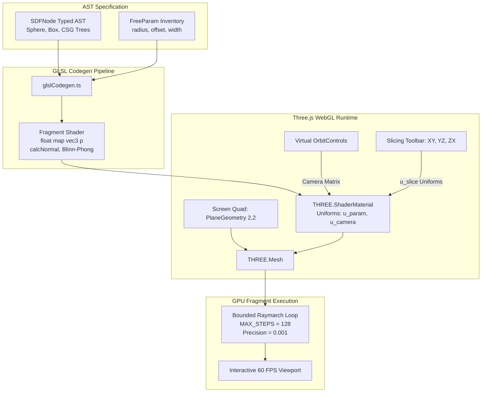

# 3D WebGL Raymarching Widget for SDFNode (Three.js + GLSL Codegen)

## 1. Overview & Architectural Motivation

In the **SymForge** interactive Web IDE, Signed Distance Functions (`SDFNode`) represent continuous 3D geometric solids and CSG boolean combinations. Rather than relying on CPU polygonization (such as marching cubes, which generates heavy polygonal meshes and introduces meshing latency), SymForge implements an **analytical client-side GLSL Raymarching pipeline**:

1. **Analytical Zero-Meshing Pipeline:** The AST is transpiled in milliseconds directly into a pure GLSL `float map(vec3 p)` function.
2. **60 FPS Real-Time Evaluation:** Rendered using Three.js over a screen-aligned quad with a custom `ShaderMaterial`, utilizing the GPU's fragment processors for camera ray casting.
3. **Interactive Orbit & Panning:** Virtual orbit controls supporting 360-degree rotation, smooth exponential zooming, and target panning.
4. **Cross-Sectional Slicing Planes:** Interactive section cuts along $XY$, $YZ$, and $ZX$ planes with continuous offset scrubbers, revealing internal hollow cavities, boreholes, and blended walls.
5. **Headless Fault Tolerance:** Built-in WebGL environment detection gracefully renders an informative fallback card in headless CI and JSDOM environments without crashes.

---

## 2. Raymarching Pipeline Architecture

```text
+---------------------------------------------------------------------------------------------------+
|                            3D WEBGL RAYMARCHING PIPELINE ARCHITECTURE                             |
|                                                                                                   |
|  [Typed SDFNode AST in Lean 4 IDE]                                                                |
|  Example: Difference(Box(1,1,1), Cylinder(0.5, 2))                                                |
|                     |                                                                             |
|                     v generateRaymarchingFragmentShader()                                         |
|  +-------------------------------------------------------------+                                  |
|  | GLSL Shader Codegen (glslCodegen.ts)                        |                                  |
|  | - Declares uniforms: u_param_<id>, u_camera_pos, u_slice_*  |                                  |
|  | - Analytical primitives: sdSphere, sdBox, sdCylinder, ...   |                                  |
|  | - Composes float map(vec3 p) distance field function       |                                  |
|  | - Normal calculation via central finite differences         |                                  |
|  +------------------------------+------------------------------+                                  |
|                                 |                                                                 |
|                                 v THREE.ShaderMaterial                                            |
|  +-------------------------------------------------------------+                                  |
|  | Three.js WebGL Canvas (SDFRaymarchWidget.tsx)               |                                  |
|  | - Screen Quad: THREE.PlaneGeometry(2, 2)                    |                                  |
|  | - Custom ShaderMaterial with dynamic uniforms               |                                  |
|  | - OrbitControls: updates u_camera_pos, u_camera_matrix      |                                  |
|  +------------------------------+------------------------------+                                  |
|                                 |                                                                 |
|                                 v Fragment Shader Execution                                       |
|  +-------------------------------------------------------------+                                  |
|  | GPU Raymarching Loop (Bounded MAX_STEPS = 128)               |                                  |
|  | - Casts primary camera ray: ro + t * rd                     |                                  |
|  | - March step: t += d, terminates when d < 0.001 or t > 25.0 |                                  |
|  | - Blinn-Phong lighting + normal-based surface coloration    |                                  |
|  | - Dynamic cross-sectional slicing plane clipping            |                                  |
|  +-------------------------------------------------------------+                                  |
+---------------------------------------------------------------------------------------------------+
```



---

## 3. Mathematical Formulation of Primitives & Operators

Every analytical primitive implemented in GLSL maps directly onto its mathematical signed distance formula:

### 3.1 Primitives
- **Sphere:**
  $$d(\mathbf{p}, r) = \|\mathbf{p}\|_2 - r$$
- **Box:**
  $$d(\mathbf{p}, \mathbf{b}) = \|\max(|\mathbf{p}| - \mathbf{b}, \mathbf{0})\|_2 + \min(\max(p_x - b_x, \max(p_y - b_y, p_z - b_z)), 0)$$
- **Cylinder:**
  $$d(\mathbf{p}, r, h) = \min(\max(d_x, d_y), 0) + \|\max(\mathbf{d}, \mathbf{0})\|_2 \quad \text{where} \quad \mathbf{d} = (\|\mathbf{p}_{xz}\|_2 - r, |p_y| - h)$$
- **Torus:**
  $$d(\mathbf{p}, R, r) = \left\| \left( \|\mathbf{p}_{xz}\|_2 - R, p_y \right) \right\|_2 - r$$
- **Plane:**
  $$d(\mathbf{p}, \mathbf{n}, h) = \mathbf{p} \cdot \mathbf{n} + h$$

### 3.2 Spatial Transforms
- **Translation:** $\mathbf{p}' = \mathbf{p} - \mathbf{offset}$
- **Rotation:** $\mathbf{p}' = \mathbf{R}_z(\gamma) \mathbf{R}_y(\beta) \mathbf{R}_x(\alpha) \cdot \mathbf{p}$
- **Scale:** $d(\mathbf{p}, s) = s \cdot d\left(\frac{\mathbf{p}}{s}\right)$

### 3.3 CSG Booleans & Smooth Blends
- **Union:** $d = \min(d_1, d_2)$
- **Intersection:** $d = \max(d_1, d_2)$
- **Difference:** $d = \max(d_1, -d_2)$
- **Smooth Union ($C^1$ Polynomial Smoothmin):**
  $$h = \operatorname{clamp}\left(0.5 + 0.5 \frac{d_2 - d_1}{k}, 0.0, 1.0\right), \quad d = \operatorname{mix}(d_2, d_1, h) - k \cdot h \cdot (1 - h)$$

---

## 4. Normal Estimation & Slicing Plane Engine

### 4.1 Central Finite Difference Normal Estimation
Surface normals $\mathbf{n}(\mathbf{p})$ are estimated on the GPU using a 4-tap central finite difference tetrahedron method with step $\varepsilon = 0.001$:
$$\mathbf{n}(\mathbf{p}) = \frac{\nabla d(\mathbf{p})}{\|\nabla d(\mathbf{p})\|_2} \approx \frac{1}{2\varepsilon} \begin{pmatrix} d(\mathbf{p} + \varepsilon\mathbf{e}_x) - d(\mathbf{p} - \varepsilon\mathbf{e}_x) \\ d(\mathbf{p} + \varepsilon\mathbf{e}_y) - d(\mathbf{p} - \varepsilon\mathbf{e}_y) \\ d(\mathbf{p} + \varepsilon\mathbf{e}_z) - d(\mathbf{p} - \varepsilon\mathbf{e}_z) \end{pmatrix}$$

### 4.2 Interactive Cross-Sectional Slicing
To inspect interior bores, hollow cavities, and internal geometries:
- Plane selection: `u_slice_plane` ($1 = XY, 2 = YZ, 3 = ZX$).
- Offset distance: `u_slice_offset`.
- The shader evaluates the distance to the half-space plane $d_{\text{plane}} = (\mathbf{p} \cdot \mathbf{n}_{\text{slice}}) - \text{offset}$ and clips the raymarch field:
  $$d_{\text{effective}} = \max(d_{\text{SDF}}(\mathbf{p}), -d_{\text{plane}}(\mathbf{p}))$$
  When a ray intersects the cut plane, it is shaded with a contrasting interior cross-section color.
